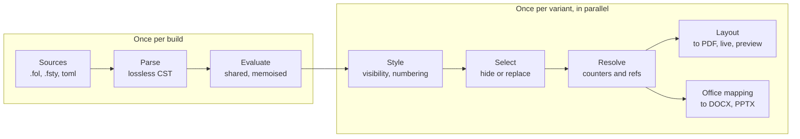
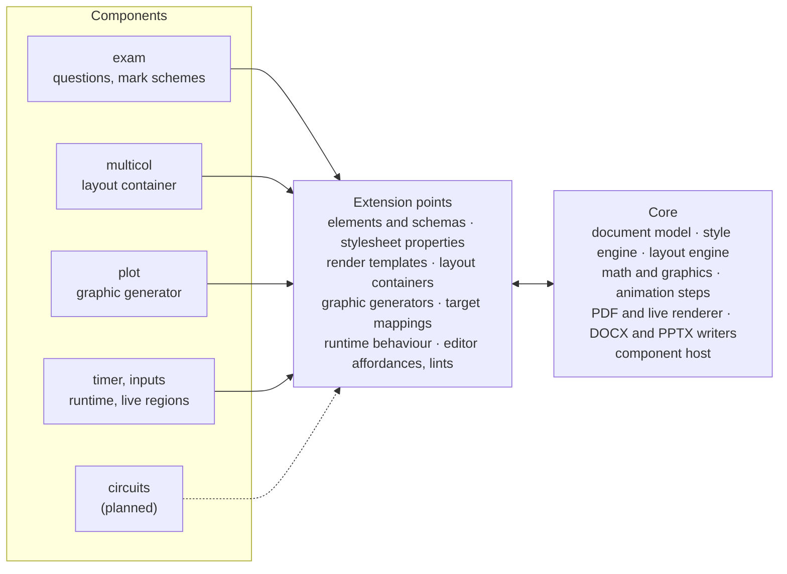
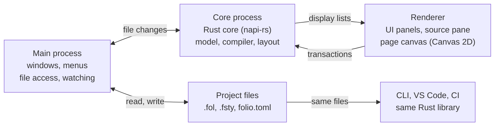

# Folio: Typesetting System Specification

Nov 23, 2026 · @Adam Markiewicz

Folio is a typesetting system written in Rust that compiles one semantic source into print-quality PDF, into Word and PowerPoint files whose look lives in real styles and slide masters, and into live presentations with animation. Content states what things are, stylesheets state how they look, and components add new kinds of content and layout without changing the core. Its primary use is teaching material: exams with mark schemes, notes and handouts, and lesson slides, from shared sources.

## 1. Introduction

### 1.1 Purpose and scope

Folio is for documents whose structure matters and whose outputs must stay consistent with each other: exam papers and their mark schemes, worksheets and notes, lesson slides with step-by-step animation, and handouts. Authors write plain-text source in a lightweight markup or work in Folio Studio, a visual editor that reads and writes the same source.

### 1.2 Requirements

| # | Requirement | Specified in |
| --- | --- | --- |
| R1 | Written in Rust; a single binary plus a library | §2 |
| R2 | Very short compile times; live output from a watched document | §2.3, §12.2, §14.1 |
| R3 | Clean separation of logical structure and styling; local overrides, and a strict mode where formatting comes only from stylesheets | §4, §5 |
| R4 | Floats, including floating margin notes | §7.5, §7.6 |
| R5 | Math typesetting | §8 |
| R6 | Baseline-grid typesetting and tables | §7.3, §7.4 |
| R7 | Text flowing around figures | §7.7 |
| R8 | User-defined objects, such as an example block | §4.3, §5.3 |
| R9 | PDF output | §11.1 |
| R10 | DOCX and PPTX output, with styling expressed as styles and slide masters | §11.2, §11.3 |
| R11 | Several documents from one source, such as an exam and its mark scheme | §6 |
| R12 | Multi-column layouts with column balancing | §13.2 |
| R13 | Graphics generated from source and styled by stylesheets | §9 |
| R14 | A visual editor built into Folio, as a desktop application | §12.4 |
| R15 | A modular architecture, in which features such as multi-column layout or circuit drawings are encapsulated components | §3 |
| R16 | Animations rendered as PDF pages or PowerPoint animations; dynamic components such as countdown timers in Folio's own renderer | §10.1–10.5, §13.4 |
| R17 | Interactive inputs, such as a slider whose value changes the parameters of generated graphics | §10.6, §13.5 |

### 1.3 Non-goals

- Compatibility with LaTeX or Typst source, macros or packages. A LaTeX math input mode is provided (§8.1), and a separate import tool is planned (§15).
- Pixel-identical DOCX and PPTX. Office files are semantically faithful and correctly styled, and Word and PowerPoint do their own line and page breaking (§11.5).
- A separate document format for the editor. Folio Studio reads and writes plain source files.
- HTML and EPUB output in 1.0. The document model avoids page assumptions so that these targets can be added later.

### 1.4 Design principles

1. **Semantic content, styled presentation.** Content says what things are; stylesheets say how they look. Local overrides exist but are tracked, and strict mode forbids them.
2. **One model, several renderers.** PDF and live views come from Folio's layout engine; Word and PowerPoint receive the styled document tree and lay it out themselves.
3. **A small core with components.** Anything that not every document needs (multi-column layout, plots, exam elements, timers) is a component with a declared interface.
4. **Incremental everything.** Every stage is memoised and invalidated precisely, so the cost of an edit is proportional to its effect.
5. **Deterministic output.** The same inputs and the same compiler version produce byte-identical outputs.
6. **Editable by design.** Source positions, node identity and edit transactions exist from the first version, so the visual editor is a front end rather than a retrofit.

### 1.5 Terminology

| Term | Meaning |
| --- | --- |
| Element | A typed node in the document tree (heading, paragraph, figure, question), built in or provided by a component |
| Component | A versioned unit that adds elements, properties, layout behaviour, graphics, target mappings or runtime behaviour through the core's extension points (§3) |
| Dynamic element | An instance of a component element with runtime behaviour, such as a countdown or a slider (§10.5) |
| Stylesheet | A separate file of rules that attach presentation to elements |
| Token | A named stylesheet value (`$accent`), reused across rules and exported to Office themes |
| Label | A name attached to an element in content (`<fig:ball>`), used by references and id selectors |
| Hint, override | Per-instance layout or formatting written in content (§5.4) |
| Layout data | A schema field holding a length or colour that is per-instance data rather than formatting, such as a drawing's scale; marked `layout-data` |
| Variant | A named output of one source: exam, markscheme, slides |
| Numbering group | A set of variants that share counters (§6.1) |
| Common tree | The union of the content visible in any variant of a numbering group (§6.1) |
| Target | An output format: `pdf`, `docx`, `pptx`, `live` |
| Edition | A version of the language's syntax and semantics, pinned in the manifest. Output is pinned by the compiler version instead (§2.4) |
| Step | One state in the animation sequence of a slide (§10) |
| Input | A dynamic element, such as a slider, whose value live regions can read (§10.6) |
| Live region | A box of reserved size whose content depends on inputs or runtime values and is redrawn without re-laying out the page |
| Region | A named area of a page master into which content flows |
| Flow | The sequence of blocks that the page builder distributes over regions |
| Fragment | A positioned box produced by layout; pages and slides are fragments |
| Flow state | Everything the page builder carries from one page to the next (§2.3) |
| Display list | The drawing commands for one fragment, used by the preview, the editor and the live renderer |
| Span map | The mapping from glyphs in a fragment back to source positions |
| Part | The content of an element's slot, or of a content field other than its body, as a node that selectors name like an element (`example > solution`) |

## 2. Architecture

Folio compiles through a pipeline of pure, memoised stages. The pipeline forks after resolution: PDF, the live presentation and the preview go through Folio's layout engine, while DOCX and PPTX are generated from the resolved, styled tree. The Office writers still use Folio's layout for measurement where they need it: slide fitting in PPTX (§11.3), and the heights of `hidden` content and automatic answer space in DOCX (§6.3).


*Visibility and numbering are styled per variant before resolution.*

Parsing and the variant-independent part of evaluation run once per build. Every stage from Style to Emit runs per variant and target, because visibility and numbering are style properties and `@target` overlays can change them.

### 2.1 Pipeline stages

1. **Parse**: source text to a lossless concrete syntax tree (CST). Parsing is error-tolerant: a broken construct becomes an error node and the rest of the file still compiles.
2. **Evaluate**: run the scripting layer (functions, loops, imports, data loading) and produce the *content tree*, a tree of element instances with typed fields. The active variant is a tracked input: only code that reads `variant` is evaluated per variant.
3. **Style**: match stylesheet rules, including overlays and local overrides, and compute a style for every node; expand render templates (§5.3). Visibility, numbering formats, `slide-break` and `reveal` are computed here. Rules with `:step(...)` are collected, not yet applied.
4. **Select**: remove nodes whose computed `display` is `none`, and substitute answer space or placeholders (§6.3).
5. **Sequence**: split the selected tree into slides (explicit `#slide` elements and `slide-break` rules, §11.3), then number the steps of each slide in document order (§10.1). Content hidden in a variant never becomes a step.
6. **Resolve**: counters, cross-references, citations and queries. Shared counters of a numbering group are resolved on the group's common tree (§6.1); everything else uses the variant's own tree.
7. **Step styling**: apply the collected `:step` rules as a style delta per step. Paint-only changes alter a step's appearance; a change to a layout-affecting property makes that step a distinct layout (§10.2).
8. **Layout** (PDF, live, preview; measurement for DOCX and PPTX): break the step-styled tree into fragments on pages or slides (§7). Page-number references iterate with layout to a bounded fixpoint (§2.3).
9. **Emit**: a target writer serialises fragments (PDF, live) or the resolved tree (DOCX, PPTX).

Live regions (§10.6) re-run Evaluate, Style and Layout for their own subtree only, on input events.

Components take part in every stage through the extension points of §3.

### 2.2 Crates

| Crate | Responsibility | Key dependencies |
| --- | --- | --- |
| `folio-syntax` | Lexer, parser, lossless CST and incremental reparsing for content and stylesheets, with one expression grammar shared by scripts, stylesheet values and render templates | Started as a fork of `typst-syntax` (Apache-2.0) |
| `folio-eval` | Interpreter for scripts, stylesheet values and render templates; standard library; content tree | — |
| `folio-model` | Element types, schemas, counters, references, queries, bibliography | `hayagriva` (CSL) |
| `folio-style` | Selector matching, cascade, computed styles as shared property groups (§5.1) | — |
| `folio-component` | Extension-point traits, component registry, manifests, conformance-test API (the suite itself runs as integration tests (tests/) with folio as a dev-dependency); the interface types shared with layout and rendering, such as Fragment and Regions | folio-text, folio-draw (glyph runs and primitives used by fragments) |
| `folio-text` | Shaping, bidi, hyphenation, line-break opportunities | `harfrust`, `unicode-bidi`, `icu_segmenter`, `hypher` |
| `folio-fonts` | Font discovery, loading, metrics; subsetting for DOCX and PPTX font embedding (§2.5), since krilla subsets fonts for PDF | `fontdb`, `skrifa`, `subsetter` |
| `folio-math` | Math parser and OpenType MATH layout, adapted from Typst's math layout (Apache-2.0) | `ttf-parser` |
| `folio-draw` | Graphic primitives, paths, label placement | `kurbo` |
| `folio-layout` | Paragraph and page builders, baseline grid, tables, floats, notes, wrap, footnotes | `folio-text`, `folio-math`, `folio-draw`, folio-component (it calls layout containers) |
| `folio-anim` | Step model, timelines, effects | — |
| `folio-runtime` | Live renderer: clock, events, dynamic elements, triggers. No tokio or threads, so it also compiles to WebAssembly (§16.1) | folio-component, folio-anim, folio-render; the live-region sub-pipeline is injected by the folio library as a callback |
| `folio-edit` | Editable model: buffers, transactions, undo, hit-testing, caret geometry, spell checking | `folio-syntax`, `folio-layout`, `spellbook` |
| `folio-render` | Display lists and their binary wire format (§12.2), glyph rasterisation, SVG and raster output. No tokio or threads, so it also compiles to WebAssembly (§16.1) | `tiny-skia`, usvg, image |
| `folio-pdf` | PDF output through krilla: tagging, PDF/UA, PDF/A, font subsetting, colour management, import of PDF figures | `krilla` |
| `folio-ooxml` | OOXML package writer; DOCX and PPTX backends; OMML; animation timing | `zip`, `quick-xml` |
| `folio-preview` | Watch server, live presentation server, websocket protocol | `notify`, `tokio` |
| `folio-lsp` | Language server, synchronous, with cancellation through the query database (§2.3) | `lsp-server` |
| `folio-node` | Node.js native addon for Folio Studio | `napi-rs` |
| `folio` (lib and bin) | Library: the memoised compile pipeline (folio::compile) and the live-region callback used by folio-runtime. Binary: command-line interface and toolchain dispatch (§2.4) | `salsa`, `clap` |

First-party components live in their own crates (`folio-component-exam`, `-multicol`, `-plot`, `-timer` and `-inputs`) and depend only on `folio-component`, never on core internals. They are compiled into the binary and versioned with it, so a project that pins the compiler version also pins them (§2.4). A fix that changes output is written once and reaches a document when its project moves to a newer compiler. The public library API is `folio::World` (sources, fonts, files, components) plus `folio::compile(world, target, variant)`. Folio Studio is a TypeScript/Electron project in the same repository that depends on `folio-node`.

The table is the target structure. Development starts with fewer crates and splits the others out as their interfaces settle: `folio-syntax`; `folio-component`, which holds from the start the interface types it shares with layout and rendering (glyph runs, graphic primitives, `Fragment`, `Regions`); one core crate for the remaining stages; `folio-pdf`; and the `folio` library and binary. The core crate depends on `folio-component`, never the reverse, so components can reach nothing else.

### 2.3 Incremental compilation

- Every stage is a query in a demand-driven, memoised database built on `salsa`. Queries record which inputs they read; an edit invalidates only the queries whose inputs changed. Component calls are queries too (§3.5).
- **Inputs and keys**: the inputs are the manifest, the lockfile, sources, data files, fonts and the component registry, which the host sets through `folio::World`. The variant and the target are keys of the per-variant queries, not inputs. A query that reads neither runs once for all variants, and the variants of one revision compile in parallel, each on its own database handle.
- **Early cutoff**: when a query re-runs and returns a value equal to its previous one, the queries that depend on it are not re-run. The convergence short-circuit of page layout, below, relies on this.
- **Cancellation**: a new edit cancels the queries still running for the previous revision, so the editor, the preview and the language server never wait for stale work.
- **Diagnostics** are side outputs of queries, not part of their results. A query reports them as it runs, and a front end collects those of a query and of every query it depends on, each query's once. A query whose result is unchanged after an edit is therefore cut off even when its diagnostics changed.
- **Durability**: bundled fonts, the standard library and first-party components are marked as rarely changing, so the validity check after an edit skips the queries that depend only on them.
- Parsing is incremental at the CST level: an edit reparses the smallest enclosing block and reuses untouched nodes.
- Evaluation is memoised per function call with argument hashing.
- Layout caches each paragraph's line breaks keyed on *(content hash, computed style hash, sequence of line widths)*, and each page keyed on its incoming flow state and page master.
- **The flow state has two parts.** The *layout part* holds what decides line and page breaks: the content position, float, margin-note and footnote queues, keep constraints, the region widths of the master, and the state of any open layout container (§3.3). The *furniture part* holds the page number, parity and running marks. Anything that can change line widths (page-number references, footnote markers that restart per page or section) belongs to the layout part instead. When only the furniture part differs (for example after a page is inserted earlier and mirrored masters have the same body width), later pages are re-dressed with new headers and footers but not re-broken.
- Page breaking is strictly forward, with no optimisation across pages. That makes the convergence short-circuit sound: re-layout starts at the first page whose key changed and stops when the outgoing layout part equals the previous run's. Container states must therefore implement `Eq` with a stable hash and hold positions and small data only, never fragments.
- Page-number references converge by a bounded fixpoint, built on salsa's cycle handling, of at most three extra passes. If they have not converged, a final pass freezes each one at its previous value, so output stays deterministic, and a warning names them.
- Fonts are loaded once per process and shared between compiles. They are memory-mapped only from the immutable font cache; files that can change (project and system fonts) are read into memory.
- Independent work runs in parallel with `rayon`: shaping, page rendering, font subsetting, and emitting several variants.

### 2.4 Determinism

The same inputs and the same compiler version produce byte-identical outputs, and fonts and components count as inputs. A project pins its fonts (bundled families, the project font directory, or fonts locked by hash in `folio.lock`; §2.5) and its third-party components and packages (versions and hashes in the same lockfile); a build fails if a locked version is not available. First-party components are versioned with the compiler (§2.2). System fonts are allowed in watch mode; in builds they produce a warning, and in strict and CI builds an error. No wall-clock time enters output: PDF IDs derive from content hashes, and DOCX/PPTX packages use a fixed timestamp or `SOURCE_DATE_EPOCH`. `folio.toml` pins two versions. The language edition (`edition = "2027"`) fixes syntax and semantics, and changes only when a project opts into a new edition. The compiler version (`compiler = "1.2.0"`) fixes output: `folio` runs the pinned version from its local toolchain cache (`folio toolchain install` adds one), so an old exam rebuilds identically years later. When the pinned version is not installed, the build fails, as for a missing locked font; `--compiler current` builds with the running version instead, with a warning. Folio Studio and the language server use their own compiler version and show a notice when it differs from the pin; export from Folio Studio runs the pinned version. Live runtime state and input values are the one exception by nature: they depend on time and user actions, but only inside the live renderer, never in files (§10.5, §10.6).

### 2.5 Fonts

- **Bundled defaults**: New Computer Modern (text and math, under the GUST Font Licence), and Source Serif 4, Source Sans 3, Source Code Pro and STIX Two (text and math), under the SIL Open Font Licence. They are compiled into the binary, so the compiler version pins them.
- **Project fonts** are the font files in `fonts/` next to `folio.toml` and its subdirectories; they pin a build as the project's other files do. A `[[font]]` of `folio.lock` is found in the project's fonts, in the immutable font cache, where each file is stored under the hash of its contents, or among the system fonts. A locked font that is not found is an error at its entry; one found with another hash is an error that names the file and both hashes.
- **Lookup**: a family is looked up among pinned faces (bundled, project and locked) first, and among system fonts only when no pinned face has it. Family names are compared without regard to case; within a family, the face closest to the requested style, then weight, then width is chosen. A family that no face has is a warning.
- **Fallback** chains are declared in the stylesheet per script (`font: "Source Serif 4", "Noto Serif"`). Text is split into runs of one script, characters of no script joining the run around them; a run is set in the first font of the chain that has all its characters, otherwise each character in the first font that has it. A glyph still missing after fallback is an error, never a silent empty box.
- **PDF** embeds subsets after checking the font's OS/2 embedding flags; a font that forbids embedding is an error.
- **DOCX and PPTX** do not embed fonts by default, so recipients without them see substitution and reflow. `embed-fonts: true` embeds TrueType fonts where the licence allows, and the export report lists the fonts recipients will need.

## 3. Component model

Everything beyond the core document model, layout and targets is supplied by components: versioned units that plug into a fixed set of extension points and interact with the rest of the system only through elements, properties and queries. Multi-column layout, plots, exam elements and countdown timers are components, and circuit diagrams will be one.


*Components reach the core only through extension points.*

The core never depends on a component; a component depends only on the published interface, so it can be added, upgraded or removed without changes elsewhere.

### 3.1 What belongs in the core

The core holds what every document needs, and what cannot be built from outside: the document model (elements, schemas, labels, counters, references, queries), the style engine, paragraph and page layout with the baseline grid, tables, floats, margin notes, wrap and footnotes, math, graphic primitives, the step model, the four targets, and the component host. The test for anything else: a feature is a component if it can be implemented through the published extension points within the performance targets of §14.1; otherwise it belongs in the core, and the missing capability is a candidate for a new extension point.

### 3.2 Extension points

| Extension point | What a component provides | Example |
| --- | --- | --- |
| Elements | Element schemas (fields, kind, slots, counters) and locale strings | `question`, `answer`, `mark` (exam) |
| Properties | Stylesheet properties: name, type, initial value, inheritance, and whether they affect layout or only paint | `column-gap` (multicol) |
| Container triggers | Properties whose value opens a layout container on an element or on a page body | `columns: 2` opens a column set (multicol) |
| Templates | Default render templates built from the closed primitive set (§5.3) | Mark-scheme table (exam) |
| Layout containers | Layout of a child flow into regions, with breaking across pages (§3.3) | Column sets (multicol) |
| Graphic generators | Graphic primitives computed from fields and data, with text measurement on request | Plots; circuit diagrams |
| States | Named element states usable as pseudo-classes; such rules may set paint properties only | `countdown:warning` (timer) |
| Page furniture | Functions for header and footer `content` | *Turn over* (exam) |
| Aggregates | Query functions over the component's elements | Total marks (exam) |
| Target mappings | Per-target output for its elements, with a declared fallback | Column sets as `w:cols` in DOCX |
| Runtime behaviour | State, a signature, event handling (ticks, pointer input, keys, input changes, core-delivered triggers, presenter controls) and views for the live renderer, plus a static fallback (§10.5). Input controls are runtime behaviours whose view publishes a value | Countdown timer; slider |
| Asset importers | Readers for data or image formats | A data-logger CSV dialect |
| Editor affordances | Declarative inspector forms, drag handles, snapping grids, insert-menu entries | A marks spinner on questions |
| Lints | Checks on its own elements | "Question has no marks" |

### 3.3 Layout containers

Layout containers are the most demanding extension point and are specified in detail, because multi-column layout must work as a component:

```rust
trait LayoutContainer {
    /// Minimum and maximum content widths, for use inside `auto` table tracks.
    fn measure(&self, flow: &ChildFlow, cx: &mut LayoutCx) -> IntrinsicSizes;

    fn layout(&self, flow: &ChildFlow, regions: &Regions,
              resume: Option<&ContainerState>, cx: &mut LayoutCx) -> ContainerResult;
}

enum ContainerResult {
    Done(Fragment),
    Break { fragment: Fragment, resume: ContainerState },  // continue in the next region
    NoFit,                                                 // move the whole container on
}

struct Fragment {
    /* positioned boxes */
    first_baseline: Abs,      // so that surrounding text can snap to the baseline grid
    last_baseline: Abs,
    keep_with_next: bool,     // keep and break constraints across the container boundary
    break_penalty_after: i32,
}
```

- The core page builder owns pages, floats, margin notes and footnotes. A container receives the regions available to it (sizes, exclusions, the baseline grid, and any footnote areas the master defines per region) and lays out its child flow by calling back into the core's paragraph and block builders through `LayoutCx`.
- **Footnotes are negotiated.** When a container's layout pulls footnotes onto the page, it calls `cx.place_footnotes(...)`, which returns the height left for the container; the container lays out again against that height. After two rounds without agreement, the core defers the last anchor line to the next page. Per-column footnote areas are a core service.
- To split across pages, a container returns `Break` with the fragment for this page and a `ContainerState`. The state implements `Eq` with a stable hash and holds positions and small data only, and it becomes part of the layout part of the flow state (§2.3).
- `NoFit` asks the page builder to move the container to the next region, as for an unbreakable block. On a fresh, empty region, `Regions` carries `must_progress: true`, and the container must return `Done` or `Break` having placed at least one line or block, with overflow if necessary. If it returns `NoFit` anyway, that is a conformance failure: the core takes the first unbreakable block of the container's child flow, places it as overflow with a diagnostic, and calls the container again with its resume position advanced past that block, so layout always terminates.
- Floats and notes anchored inside a container are passed back to the core with their anchor positions; a container may offer extra float areas, such as the tops of individual columns.
- A page master can open a container for its whole body (a container trigger on `page`), so a document set entirely in columns uses the same mechanism.
- Measurement requests are memoised by the core.

### 3.4 Tiers

| Tier | Written in | Runs in | Extension points | Typical use |
| --- | --- | --- | --- | --- |
| Package | Folio language and stylesheets | The evaluator sandbox | Elements, properties with stylesheet defaults, templates, locale strings, lints | House styles, question types, school templates |
| WebAssembly (after 1.0) | Any language compiled against the published WIT interface | A `wasmtime` sandbox with fuel and memory limits | All except layout containers | Third-party computation, such as circuit layout |
| Native | Rust against `folio-component` | The Folio process, compiled into the binary | All | First-party components that need speed or layout containers |

The native interface is defined in WebAssembly-compatible terms (plain data in and out, no references into core internals, except the layout-container callback, which is why that extension point stays native) so that the WebAssembly tier can be added without changing it.

### 3.5 Contracts

- **Pure and deterministic.** Outputs depend only on declared inputs: element fields, computed style, data files and measurements. No clock, randomness or I/O beyond declared assets; runtime behaviour is the exception described in §2.4.
- **Memoisable.** Every extension-point call is a query; components declare the properties they read, so restyling invalidates them precisely.
- **Encapsulated.** A component cannot see another component's state; components interact only through elements, properties, labels and queries. Cross-element triggers at runtime (a button starting a countdown) are resolved by the core, which delivers a `Triggered` event (§10.5).
- **Paint-only states.** Rules on component states (pseudo-classes) and on runtime states may set paint properties and effects only, so a state change repaints without re-layout. A dynamic element's states and published values are declared in its signature (§10.5); the compiler checks that each state fits its reserved size, and checks live regions by sampling (§10.6).
- **Two version axes.** A component declares the interface version it targets (`folio-component = "1"`), which is stable across the compiler versions that support it; separately, first-party components are versioned with the compiler, which the project pins (§2.2, §2.4).
- **Total.** A component declares the targets it supports. For any other target the fallback chain is a generic mapping (render as a picture, or flatten to text), then a placeholder with a warning. A missing mapping never fails a build.
- **Tested.** A conformance suite in `folio-component` checks determinism, fallbacks, incremental behaviour and replay of runtime event logs; every component ships golden tests.

### 3.6 Declaring components

```toml
[components]
"@school/house" = { path = "../house-style" }    # a package component
circuits = { version = "0.3" }                   # a third-party component
disable = ["plot"]                               # first-party components are on by default
```

- First-party components (§13) are available without declaration and pinned with the compiler version (§2.4); they can be disabled. Other components are declared and pinned in `folio.lock`.
- **Namespaces.** Elements and properties belong to their component's namespace and can always be written qualified (`exam.question`, in content and in selectors). A component's namespace is its name, or the part after the scope for a scoped name (`house` for `@school/house`); two components with the same namespace cannot be registered together. Unqualified names resolve as recorded in the lockfile, so a component that adds an element in a later version cannot change how an existing document resolves; a new clash after an upgrade is a warning, and the lockfile's binding stays until the author chooses.

## 4. Document model and source language

A Folio project is plain text: content files (`.fol`) hold structure and text, stylesheets (`.fsty`) hold presentation, and a manifest (`folio.toml`) ties them together with components, variants and targets.

### 4.1 Project layout and manifest

```
mechanics-test-3/
  folio.toml          # manifest
  folio.lock          # pinned fonts, components and packages
  main.fol            # content entry point
  questions/*.fol     # included content
  styles/*.fsty       # stylesheets
  fonts/              # project fonts (§2.5)
  assets/             # images and data files
```

```toml
[project]
entry = "main.fol"
edition = "2027"
compiler = "1.2.0"
lang = "en"
styles = ["styles/exam.fsty"]

[components]
"@school/house" = { path = "../house-style" }

[variants.exam]
targets = ["pdf", "docx"]

[variants.markscheme]
targets = ["pdf"]
styles = ["styles/markscheme.fsty"]

[formatting]
mode = "local"          # or "strict" (§5.5)
```

| Key | Meaning | When omitted |
| --- | --- | --- |
| `project.entry` | The content file that compilation starts from | Required |
| `project.edition` | The language edition (§2.4); `"2027"` is the first | Required |
| `project.compiler` | The exact compiler version that fixes output (§2.4) | Required |
| `project.lang` | The document language as a BCP 47 tag; it chooses locale strings (§4.5) | `"en"` |
| `project.styles` | Project stylesheets, applied in order to every variant | None |
| `project.today` | The date that scripts see as `today`, a TOML date such as `2026-11-24` (§4.4) | From the command line |
| `[components]` | Components by path or version, and `disable` (§3.6) | First-party components only |
| `[variants.<name>]` | `targets` (one or more of `pdf`, `docx`, `pptx`, `live`) and overlay `styles` (§6.1) | No variants: the document is built once, for PDF |
| `[numbering-groups.<name>]` | `variants` and `shared-counters` (§6.1) | No groups |
| `[formatting]` | `mode`, `strict-paths`, `overrides-sheet`, `allow-overrides-sheet` (default `true`) and `allow-local-packages` (default `false`) (§5.5) | `mode = "local"` |
| `[output]` | `path` of each output file, with the placeholders `{stem}` (the entry file's name), `{variant}` and `{ext}` (§6.4) | `"out/{stem}-{variant}.{ext}"` |

- Paths are relative to the directory that holds `folio.toml` and use `/` as separator. The entry file, stylesheets, the overrides sheet, `strict-paths` and the output path stay inside the project; only a component path may leave it.
- Unknown keys are errors. Every error points at the key or value at fault, and all errors in the file are reported together.
- `strict-paths` is an error unless `mode = "strict"`. An output path that would give two outputs the same file is an error.

Folio writes `folio.lock`; it is not edited by hand:

```toml
version = 1             # the lockfile format

[[font]]
family = "Source Serif 4"
postscript-name = "SourceSerif4-Regular"
hash = "sha256:7ed03dbffad50d535f26744437f8675ae06a442c9314e87bbbe56f0f3cb74be4"

[[component]]
name = "circuits"
version = "0.3.2"
hash = "sha256:e5895263db42699c3f2fcc16368c140c48e05d2b7617880e0c78e5c994081e68"

[bindings.elements]
question = "exam"
circuit = "circuits"
```

`[[font]]` locks a font face by the SHA-256 hash of its file. `[[component]]` and `[[package]]` record the exact version and content hash of each declared component and of each imported package. `[bindings.elements]` and `[bindings.properties]` record the component that each unqualified name resolves to (§3.6); a binding names a first-party component or a locked one.

### 4.2 Content markup

The markup is lightweight, so plain prose reads as prose:

```
#doc(title: "Mechanics: Test 3", subject: "WPH11")

= Kinematics <sec:kin>

A ball is thrown vertically upwards with speed $u = qty(12, "m s^-1")$.
Air resistance is negligible.#sidenote[Take $g = qty(9.81, "m s^-2")$.]

#figure(placement: wrap, side: outer, width: 1/3)[
  #image("assets/ball.svg")
][Path of the ball.] <fig:ball>

#question(marks: 3)[
  Calculate the maximum height reached. See @fig:ball.
  #answer(lines: 4)[
    $h = u^2 / (2g) = qty(7.3, "m")$ #mark("M1") #mark("A1")
  ]
]
```

| Construct | Syntax | Produces |
| --- | --- | --- |
| Paragraph | Text separated by blank lines | `paragraph` |
| Heading | `=`, `==`, `===` | `heading(level: n)`; headings open nested `section` elements |
| Emphasis, strong | `_text_`, `*text*` | `emph`, `strong` (semantic, not italic and bold) |
| Lists | `-` bullet, `+` numbered, `/ term:` description | `list`, `enum`, `terms` |
| Math | `$...$` inline; `$ ... $` with inner spaces for display | `math` (§8) |
| Element call | `#name(field: value)[body]` | Any built-in or component element |
| Label, reference | `<id>` after a node or body; `@id` | A resolved reference (§4.5) |
| Raw text, code | Backticks and fenced blocks | `raw(lang: ...)` |
| Comment | `//`, `/* */` | Nothing |

- **Fields.** Element calls accept the semantic fields declared in the element's schema plus the universal fields: `class` (style hooks such as `class: "hard"`), `id` (the same as a label), `steps` and `handout` (§10.1, §10.4), `override`, and the layout hints listed in §5.4. No element has fields such as `font`, `size` or `color`.
- **Keywords and scopes.** The layout hints and `handout` take a bare keyword as a stylesheet writes it (`placement: wrap`, `handout: keep`); an identifier that names a variable is that variable's value instead. Only `override` and the layout hints can be limited to a variant or target (`override@markscheme`), and the scope must name a declared variant or a target; content that differs by variant is written with `#if variant == ...`.
- **Structure.** Evaluation gives a flat sequence of content; the document model gives it structure. The document is a `doc` element, whose fields come from one `#doc(...)` at the top level and whose body is the rest of the document. In a body that holds blocks, inline content between blocks becomes a `paragraph` (a float written in a paragraph's text stays in it as its anchor, §7.5), consecutive list items become one `list`, `enum` or `terms`, and each heading opens a `section` that holds it and the blocks after it, up to the next heading of the same or a higher level. Sections never cross the boundary of the element that holds them.
- **Labels** consist of letters, digits, `-`, `_` and `:`, start with a letter, digit or `_`, and do not end with `:` or `-`; they cannot contain `.`, which separates a label from a published value (`<timer:task>.remaining`, §10.6). A reference in running text therefore never ends with `:` or `-`, so in "see @fig:ball: it shows" the final colon is punctuation.
- **Sigils.** `$` starts math, `#` starts an element call and `@` a reference. Stylesheet tokens are therefore written `tok.accent` in content (`$accent` in stylesheets), and colours `rgb("1f5fa8")`.
- **Per-instance data** that is not formatting is content in every mode: the number of grid columns, the number of answer lines, a drawing's scale.
- **Relation to Typst.** The markup follows Typst's wherever Folio has no reason to differ, so authors who know Typst meet few surprises, and `folio-syntax` started as a fork of Typst's parser (§2.2). Folio's own constructs are element declarations (§4.3), scoped rules (§5.4), quantities and LaTeX math mode (§8.1), and the label grammar above. Typst's `set`, `show` and `context` are not part of the language, because styling lives in stylesheets. Source compatibility remains a non-goal (§1.3).

### 4.3 Elements

Every element, built in or added by a component, has a declared schema. A package component (§3.4) can declare one in Folio's own language:

```
#element example(
  title: content = none,
  numbered: bool = true,
  difficulty: choice("core", "extension") = "core",
) {
  kind: block                         // block | inline | float | note | slide
  body: slots(statement: blocks, solution: blocks)
  counter: within heading(level: 1)
  ref-key: "example"                  // word looked up in locale files
}
```

- **Fields** are typed (`content`, `str`, `int`, `number`, `bool`, `choice(...)`, `ref`, arrays and dictionaries) with defaults. Wrong types and unknown fields are compile errors with a source span. Length and colour fields are allowed only when marked `layout-data` (§5.5). A `content` field holds inline content, and a `ref` field a label (`see: <fig:ball>`).
- **Positional fields.** A schema can list fields that a call gives by position, in order; `body` in the list places the body, which otherwise comes after them. A call's trailing content blocks are positional arguments, so `#image("assets/ball.svg")` gives `path`, and `#figure[...][Path of the ball.]` gives `body` and then `caption`.
- **Kind** tells layout and the target writers how the element behaves: in the flow, in a line, placeable (§7.5), anchored to a line and placeable in a margin (§7.6), or a slide (§10).
- **Content model** constrains the body: none, inline content, blocks, or named slots. Named slots are filled with sub-blocks (`#statement[...]`, `#solution[...]`) and can be styled separately (`example > solution`). The slot names are defined only inside the element's arguments, where they hide variables of the same name; each slot is filled at most once, and an instance stores each slot's content as a field of that name.
- **Counter** and **ref-key** make the element numberable and referenceable: `@ex:slope` renders as *Example 2.3*, with *Example* taken from the locale file for the document's language.

```
#import "lib/blocks.fol": example

#example(title: [Projectile on a slope], difficulty: "extension")[
  #statement[A particle is projected ...]
  #solution[Resolve along the slope ...]
] <ex:slope>
```

### 4.4 Scripting and data

- Expressions, `#let` bindings, functions, `#if`, `#for`, and modules through `#import`.
- Import and include paths are string literals, relative to the importing file or, with a leading `/`, to the project root. The files a document reads are therefore known before any script runs, and an import that would form a cycle is an error.
- Data loading from CSV, JSON, TOML, YAML and BibTeX/CSL-JSON, so a question bank or a results table can drive content.
- A deterministic sandbox: file reads are limited to the project root and declared assets; there is no network access and no clock (a `today` value comes from the manifest or the command line).
- Resource limits on steps, memory and recursion; exceeding one is an error that points at the call.
- One expression language serves scripts, stylesheet values and render templates (§5.1, §5.3), with one grammar in `folio-syntax` and one evaluator in `folio-eval`.

### 4.5 Counters, references, queries and citations

- Counters are declared on elements or in stylesheets and resolved per variant. Counters shared by a numbering group are resolved as described in §6.1.
- `@id` renders according to the target's `ref-format`: *Question 3*, *Figure 2.1*, *page 4*. A reference to an element hidden in the current variant is an error in strict mode and a warning otherwise.
- Queries: `#total(question, "marks")` uses the numbering group's common tree, so cover page and mark scheme show the same total; `#outline(heading)` and `#list-of(figure)` use the variant's own tree and never list hidden items.
- Page-number references are resolved by the bounded fixpoint of §2.3.
- Generated words (*Question*, *Figure*, *page*, *Turn over*) come from locale files chosen by `lang`; English and Polish are built in.
- Citations use `@key` against BibTeX or CSL-JSON files with a CSL style named in the stylesheet; `#bibliography()` prints the list.

## 5. Styling

Stylesheets attach presentation to elements with CSS-like rules. Values can be computed and render templates can rearrange an element, but rule structure stays declarative, so the editor can rewrite rules and the Office writers can map them to styles (Appendix A explains the choice).

### 5.1 Stylesheets

```
@import "school-base.fsty";

page {
  page-size: A4;
  margin-top: 20mm; margin-bottom: 20mm;
  margin-inner: 18mm; margin-outer: 45mm;          // wide outer margin for notes
  margin-column: outer, width 32mm, gap 6mm;
  baseline-grid: 13pt;
}

heading[level=1] {
  font: "Source Sans 3"; font-size: 16pt; font-weight: 700;
  space-before: 18pt; space-after: 6pt; keep-with-next: true;
  numbering: "1.";
  export-name: "Heading 1";                         // Word style / PPTX title style
}

question {
  numbering: "1.";
  marker-position: hanging 8mm;
  trailer: align-end "[" field(marks) " marks]";
  export-name: "Question";
}

sidenote { placement: margin; font-size: 8.5pt; font-style: italic; }
heading + paragraph { indent: 0; }
```

- **Selectors**: element name, `.class`, `#{fig:ball}` (a labelled element; braces because labels may contain `:`), `[field=value]` and `[field>3]`, descendant (`question answer`), child (`>`), adjacent sibling (`+`), `:first`, `:last`, `:nth(n)`, :nth-col(n) (table cells), `:has(child)` limited to direct children, and the state pseudo-classes `:step(...)` (§10.2) and component states (which may set paint properties only), such as `:expired` (§13.4). General sibling (`~`) and deep `:has` are excluded; rules using `+`, `:first`, `:last`, `:nth`, `:nth-col` or `:has` register sibling dependencies, so an insertion restyles only the siblings of the changed node.
- **Names in selectors**: an element name resolves as in content (§3.6). `page` names the page master. The content of a slot or of a content field other than the body is a *part*, named like an element (`example > solution`, `figure > caption`). `exam.question` (a qualified name) and `example.short` (an element with a class, §5.3) have the same form: `a.b` is the element `b` of component `a` when `a` is the namespace of a component in use, and the element `a` with the class `b` otherwise. Where a namespace is also an element's name, the lint `namespace-element` warns. An unknown element name is a warning, and its rule matches nothing.
- **Cascade**: origin first (built-in and component defaults < imported theme < project stylesheet < variant overlay < target overlay < overrides stylesheet < local overrides in content), then specificity, then source order. `!important` does not exist.
- **Inheritance**: text properties (font, size, language, colour), paragraph properties (leading, indent, alignment, hyphenation) and graphic properties inherit down the tree; box properties (space, borders, padding, placement) do not. A component declares inheritance per property.
- **Values** are evaluated with the expression language of scripts (§4.4): `$body-size * 1.2`, `rgb("1f5fa8")`. Stylesheets have no variables, so a bare word is a keyword (`outer`, `solid`) and a call of a name that is no function of the standard library is a keyword with arguments (`wipe(from-left)`). A zero needs no unit, and a property that takes a list takes a single item as a list of one. A length in `em` is relative to the element's font size, and for `font-size` to its parent's; it inherits as the absolute length it computes to. A value that does not fit its property's type is an error at the declaration, and the declaration is ignored.
- **Computed styles** are stored as shared, reference-counted property groups (§5.2), so nodes with equal styles share memory, and the style hashes in layout cache keys (§2.3) are cheap to compute.
- **Lossless parsing**: stylesheets are parsed into the same kind of lossless syntax tree as content (§2.1), so the editor (§12.4) and `folio promote` (§5.4) rewrite rules without disturbing comments or formatting.
- **Tokens**: `$accent: #1f5fa8;` and `$body-size: 11pt;` are defined once and reused; they map to Office theme values explicitly (§11.2).
- **Overlays**: `@variant markscheme { ... }` and `@target pptx { ... }` blocks contain rules that apply only there; both accept comma-separated lists (@variant slides, handout).
- **One meaning per name**: `font-size`, `font-style` and `page-size` are distinct; `columns` means text columns (§13.2) and `column-tracks` table columns (§7.4); `numbering` always takes a pattern string (`"1."`, `"(a)"`, `"i"`).

### 5.2 Property groups

| Group | Examples | Applies to |
| --- | --- | --- |
| Text | `font`, `font-size`, `font-weight`, `font-style`, `tracking`, `features`, `lang`, `color` | Inline and block |
| Paragraph | `leading`, `indent`, `align`, `justify`, `hyphenate`, `widows`, `orphans`, `grid-snap` | Blocks containing text |
| Block | `space-before/after`, `padding`, `border`, `background`, `keep-with-next`, `keep-together`, `break-before`, `breakable`, `trailer` | Blocks |
| Numbering | `numbering`, `counter-reset`, `marker`, `marker-position`, `ref-format` | Numbered elements |
| Visibility | `display`, `show-only` (which slots or child elements are shown) | Any element |
| Templates | `template` (selects a named render template) | Elements with templates |
| Placement | `placement`, `side` (`inner`, `outer`, `left`, `right`), `float-order`, `wrap`, `wrap-gap` | Floats and notes |
| Page | `page-size`, `margin-*`, `margin-column`, `baseline-grid`, `header`, `footer`, `content` | `page` and named masters (`page.handout`) |
| Graphics | `stroke`, `fill`, `symbol`, `head`, `palette` | Graphic elements (§9) |
| Animation | `entrance`, `exit`, `emphasis-effect`, `state-effect`, `transition`, `duration` | Elements on slides (§10.2) |
| Slides and live | `reveal`, `animation`, `live-static`, `overflow`, `reserve`, `fallback`, `slide-break`, `slide-role`, `slide-layout`, `slide-overflow`, `slide-fit-margin` | Slides, lists, dynamic elements and live regions (§10, §11.3) |
| Export | `export-name`, `export-as`, `docx-*`, `pptx-*` | Mapping to Office (§11) |

Components add their own groups through the Properties extension point, for example `columns`, `column-gap` and `column-fill` from multicol.

### 5.3 Render templates

A render template rearranges an element's parts. Templates are built from a closed set of primitives: `row`, `stack`, `grid`, `box`, `rule`, `slot`, `field`, `counter`, `term`, `text`, `strong`, `emph`, `badge`, `image`, `space`, `align-*`, and the graphic primitives of §9. Because the set is closed, every template has a defined export to Office, falling back to a picture for nested layouts.

```
example {
  padding: 3mm 4mm; border-left: 1.5pt solid $accent; background: $accent-tint;
  space-before: 8pt; space-after: 8pt; breakable: true;
  export-name: "Example";
}

render example {                                   // default template
  header: row(
    strong(term() " " counter() if field(title) { ": " field(title) }),
    align-end(badge(field(difficulty))) if field(difficulty) == "extension",
  );
  body: slot(statement) rule(0.4pt) slot(solution);
}

render example as compact { body: slot(statement); }   // named template
example.short { template: compact; }
```

| Template uses | DOCX | PPTX |
| --- | --- | --- |
| Block properties only (border, background, padding, spacing) | A paragraph style named by `export-name`, with borders and shading | In a placeholder: the master's text styles. Elsewhere: a shape formatted directly with theme colours and fonts |
| A header row plus body | A one-cell table with a named table style | Grouped shapes formatted with theme values |
| `grid` with several cells | A table with a named table style | A table with a table style |
| Graphic primitives | A picture (SVG with PNG fallback), or editable shapes with `export-as: native` | The same |

Where a property has no Office equivalent, the writer uses the nearest one and reports it; content is never dropped.

### 5.4 Local overrides

Local overrides change the look of one object or passage without editing a stylesheet. They use the stylesheet's properties and validation, and they rank above every stylesheet origin, weakest first:

| Form | Syntax | Scope | Lives in |
| --- | --- | --- | --- |
| Id rule in the overrides stylesheet | `#{fig:ball} { width: 40%; }` in `styles/overrides.fsty` | One labelled element | Stylesheet |
| Scoped rule | `#rule question { numbering: "(a)"; }` | The whole enclosing element, wherever the rule sits in it | Content |
| Instance hint | `#figure(placement: wrap, width: 1/3)[...]` | One element, layout only | Content |
| Override attribute | `#question(marks: 3, override: (space-before: 24pt))[...]` | One element | Content |
| Styled span or block | `#styled(color: tok.warn, font-weight: 700)[read carefully]` | The wrapped content | Content |

- **Hints** are the per-instance layout decisions: `placement`, `side`, `width`, `wrap-shape`, grid `column-tracks`, `break-before`, `keep-with-next`.
- **Scoping**: overrides can be limited to a variant or target (`override@markscheme: (...)`, `#rule @target pptx figure { ... }`).
- **Tracking**: every override in content is listed by `folio check --report overrides`, shown by the language server, and marked in the editor. A raw literal such as `rgb("d62728")` triggers the lint `override-literal`, suggesting a token.
- **Promotion**: `folio promote` or the editor moves an override out of content, either into a class rule (the content gets `class:`) or into an id rule in the overrides stylesheet, adding a stable generated label if the element has none.

### 5.5 Strict mode

Strict mode makes stylesheets the only source of formatting, for a project, for chosen folders, or for one build.

```toml
[formatting]
mode = "strict"                     # "local" (default) or "strict"
strict-paths = ["questions/**"]     # optional: strict only here
overrides-sheet = "styles/overrides.fsty"
allow-overrides-sheet = true        # id rules allowed in strict mode
```

| Behaviour | `local` | `strict` | `strict`, no overrides sheet |
| --- | --- | --- | --- |
| Overrides in content | Allowed, tracked | Error, with a quick fix that moves them to a stylesheet | Error |
| Id rules in the overrides sheet | Allowed | Allowed | Error |
| Element and class rules | Allowed | Allowed | Allowed |
| Direct formatting from content in DOCX/PPTX | For content overrides | None | None |
| Formatting in Folio Studio | A local formatting panel applies tracked overrides | Formatting one element writes an id rule to the overrides sheet | Formatting is possible only by creating or editing classes |

- `folio build --strict` forces strict mode for one build, typically in CI; `--strict=report` lists violations without failing.
- A component or package declares its own mode; a strict project may use one that relies on local overrides only with `allow-local-packages = true`.
- Strict mode is checked syntactically. It guarantees that content carries no visual properties, not that it carries no presentational intent: the lint `presentational-class` warns about class names such as `.red`, and schemas may declare length or colour fields only when marked `layout-data`.
- Office output in strict mode has no direct character or paragraph formatting that originates in content. Properties that Office cannot express as styles (anchors, table widths, section settings) can still occur and are listed in the export report.

## 6. Variants

A variant is a named view of one document: it selects which content is present and which stylesheet overlays apply. One `folio build` produces every declared variant in parallel, sharing parsing and the variant-independent part of evaluation.

### 6.1 Declaring variants and numbering groups

```toml
[variants.exam]
targets = ["pdf", "docx"]

[variants.markscheme]
targets = ["pdf"]
styles = ["styles/markscheme.fsty"]     # overlay appended to the project styles

[variants.slides]
targets = ["pptx", "live"]
styles = ["styles/slides.fsty"]

[variants.handout]
targets = ["pdf"]
styles = ["styles/slides.fsty", "styles/handout.fsty"]   # one page per slide (§10.4)

[numbering-groups.paper]
variants = ["exam", "markscheme"]
shared-counters = ["question", "part", "figure", "equation"]
```

A **numbering group** names variants that must agree on numbering; a variant belongs to at most one. Its shared counters are resolved on the group's *common tree*: the union of the nodes visible in each of its variants, styled with variant overlays but without target overlays, so that format-specific rules cannot change shared numbering. Other counters, and variants outside any group, number their own visible content. When a variant has no target overlays, the common-tree pass reuses its normal Style and Select results, so the extra cost arises only where target overlays exist. Sections 2.1, 4.5 and 6.4 rely on this rule.

### 6.2 Selecting content

Three mechanisms, from most to least preferred:

1. **By element, in the stylesheet.** Content says what things are; the variant overlay decides visibility, so content files carry no variant logic.

```
// exam.fsty
answer { display: answer-space; }
mark   { display: none; }

@variant markscheme {
  answer   { display: block; template: markscheme-box; }
  mark     { display: inline; template: badge; }
  question { show-only: answer mark; }          // stem condensed, answers prominent
}
```

2. **By condition, in content**, for one-off text: `#in-variant("markscheme")[Accept 7.2 to 7.4 m.]` and `#except-variant("exam")[...]`. These are elements, so they stay stylable and visible to the tools.
3. **By script**, for generated content: `#if variant == "slides" { ... }`. The linter suggests mechanism 1 or 2 where possible.

### 6.3 Display modes

| `display` | Effect | Typical use | In DOCX |
| --- | --- | --- | --- |
| `none` | Removed, no space | Mark codes in the exam paper | Removed |
| `hidden` | Space kept, nothing drawn | Keeping exam and mark scheme pagination aligned | Empty space of the height measured by Folio |
| `answer-space` | Ruled lines or a box; height from `#answer(lines: n)`, `answer-height`, or `auto` (the answer's own height × `answer-scale`, measured in a discarded layout) | Answer space in a student paper | Ruled lines or an empty bordered frame |
| `placeholder("...")` | Replaced by a text | "Solution in the mark scheme" | The text |
| `block`, `inline` | Shown normally | Mark scheme | Normal content |

### 6.4 Guarantees

- **Numbering and totals**: shared counters and `#total` are identical in all variants of a numbering group (§6.1). Steps never affect numbering.
- **Per-variant lists**: outlines, figure lists and references never mention content hidden in the variant.
- **No answer leakage**: content removed or replaced in a variant never reaches that variant's outputs in any form: text, PDF tags, alt text, bookmarks, metadata, hidden Word runs, comments, speaker notes, animation steps, data embedded in graphics, or data sent to live clients (animation time functions and display lists).
- **Leak check by provenance**: every emitted glyph, tag, OOXML run and display-list item carries the id of its source node, and `folio check --leaks` fails if any of them comes from a node removed in the variant. A text search is the second line of defence: text is extracted as a reader would see it (ToUnicode maps in PDF, the OOXML text model with runs joined), normalised, and searched for word sequences of at least six words or 30 characters from hidden nodes, with a project allowlist. The check runs by default in strict and CI builds and covers every target.
- **Shuffled versions**: `#shuffle(seed: "B")` reorders questions during evaluation, so each version is numbered in printed order; each version and its mark scheme form their own numbering group.
- **Output naming**: `out/{stem}-{variant}.{ext}` by default, configurable with `[output] path` in the manifest (§4.1).

## 7. Layout engine

Layout turns the resolved tree into pages of positioned fragments in two levels: a paragraph builder that breaks text into lines against a possibly irregular shape, and a page builder that fills regions on page masters while managing queues of floats, margin notes and footnotes. Layout containers from components (§3.3) plug into the page builder.

### 7.1 Pages, masters and regions

- A **page master** defines the page size and named regions: `body`, `header`, `footer`, `margin-inner`, `margin-outer`. Slides are pages with a slide master (§11.3).
- Masters are chosen by rules (`page:first`, `page:left`, `page:right`) or by name: `page.landscape { ... }` defines a master and `break-before: page(landscape)` starts one.
- Two-sided documents mirror inner and outer regions on left-hand pages; a note with `side: outer` always lands in the outer margin.
- `page-count-multiple: 2` (or 4 for booklets) pads the document with pages from a `blank` master, which can print *This page is intentionally left blank*.

### 7.2 Paragraphs and lines

- Shaping with `harfrust`, script and language itemisation, bidi reordering (UAX #9), break opportunities (UAX #14, with `icu_segmenter`, which also handles scripts written without spaces), and hyphenation patterns per language.
- **Line breaking** uses the Knuth–Plass total-fit algorithm with line widths given per line index. Where the shape depends on vertical position (text wrap, §7.7), leading is fixed so that the line index determines the position; a line taller than the leading, such as one with tall inline math, triggers a re-break with the shape recomputed from that line.
- Knuth–Plass takes well under a millisecond for ordinary paragraphs. Only a paragraph that exceeds 5 ms is broken greedily while typing, and gets the optimal result once the editor is idle.
- **Language rules**: hyphenation, quotation marks and line-end rules per language. In Polish, single-letter words (a, i, o, u, w, z and their capitals) are never left at the end of a line; a non-breaking space is inserted automatically.
- Character protrusion (hanging punctuation) is optional.
- Widow and orphan control, `keep-with-next`, `keep-together` and break penalties are costs, not hard rules, so an impossible constraint produces the least-bad page and a warning rather than an overfull page.

### 7.3 Baseline grid

Body text sits on a baseline grid, so lines are at the same heights on every page, across columns, and through the sheet when printed double-sided.

- `page { baseline-grid: 13pt; grid-offset: 0; }` defines the grid for the body; margin columns share it, so margin notes align with body lines.
- Body paragraphs snap every baseline to the grid (`grid-snap: lines`, the default when a grid is set); their leading equals the grid.
- Blocks that are not a whole number of grid lines tall (headings, display math, figures, tables, spaced lists) snap as a block (`grid-snap: block`): the space after them grows so that the next body line lands on the grid; `grid-snap-align: below | above | centre` decides where the excess goes.
- Multi-line headings can use a finer grid (`grid-snap: 1/2`); footnotes and margin notes can use a secondary grid (`footnote-grid: 10pt`).
- Layout containers receive the grid with their regions, so column sets keep baselines aligned (§13.2).
- The preview and editor offer an overlay that shows the grid and highlights off-grid lines.
- DOCX approximates the grid with exact line spacing equal to the grid for grid-snapped lines, and pads every block to a whole number of grid lines: the excess of `grid-snap: block` becomes space before and after the block, split as `grid-snap-align` places it. Word does not snap back to the grid after an off-grid block, and its document grid (`w:docGrid`) does not move lines with exact spacing, so the padding carries the grid. Word drops space before at the top of a page, so a block that starts a page loses any excess above it, and the lines after it are off the grid until the next page; with `grid-snap-align: below` this cannot happen. Elsewhere baselines match Folio's where Word breaks lines as Folio does; where it does not, a block's height changes and the following lines are off the grid until the next page (§16.2). PPTX ignores the grid.

### 7.4 Tables

One `grid` primitive serves tables and layout grids:

```
#grid(column-tracks: (auto, 1fr, 1fr), header-rows: 1)[
  [Quantity] [Symbol] [Unit]
  [Velocity] [$v$] [$"m s"^(-1)$]
  #cell(colspan: 2)[Spans two columns] [x]
]
```

- **Tracks**: `column-tracks` and `row-tracks` take fixed lengths, fractions (`fr`), `auto`, `minmax(a, b)` and `repeat(n, track)`. The number of tracks is content; their widths are a hint or come from the stylesheet.
- **Cells** span rows and columns and are placed explicitly or by auto-flow; alignment, padding and strokes come from the stylesheet (`grid.results > cell:nth-col(1) { align: start }`).
- **Track sizing** follows a CSS-grid-like algorithm: fixed tracks, then `auto` tracks by min- and max-content, then remaining space to `fr` tracks, with one extra pass for spanning cells.
- **Baseline grid**: with `grid-snap: rows`, row heights round up to whole grid lines.
- **Page breaking**: rows break between pages, header rows repeat, and a row splits only with `row-breakable: true`.
- DOCX: a Word table with a named table style; PPTX: a table with a table style.

### 7.5 Floats

An element of kind `float` (figures, tables, component floats) leaves the flow at its anchor and is placed by the page builder according to `placement`:

| `placement` | Meaning |
| --- | --- |
| `here` | In the flow where it stands |
| `top`, `bottom` | Top or bottom of the current or a later body region |
| `page` | On a float-only page |
| `auto` | Here, then top, bottom, page |
| `wrap` | In the flow, with text wrapping around it (§7.7) |
| `margin` | In a margin region, aligned with its anchor line (§7.6) |

- Floats keep source order within a float class (`float-order`), are never placed before their anchor's page, and drift at most `max-defer` pages before a float page is forced.
- Per-page limits (`float-area-max: 70%`, `text-area-min: 20%`, `max-floats-top: 2`) are page properties.
- Placement is chosen by cost (distance from the anchor, page fill, deferral) among a few candidate positions, not by a fixed cascade.
- Layout containers may offer their own float areas, such as the tops of individual columns.

### 7.6 Margin notes

Margin notes are elements of kind `note`: the built-in `sidenote` and `marginfigure`, and component elements of that kind.

- **Anchoring**: a note's first baseline aligns with the line containing its anchor.
- **Collisions**: notes in one margin are stacked. A note that would overlap the previous one is pushed down; if it would pass the region foot, earlier notes on the page move up (never more than `note-max-raise` above their anchors) before the note moves to the next page with a `→ p. 5` marker set in the margin beside its anchor line, so the main text is not re-broken.
- **Numbering**: superscript markers (`sidenote { marker: counter }`) or unmarked notes.
- **Margin figures** use the same mechanism, sized to the margin column; `bleed: body 20mm` lets a wider one extend into the body. This is allowed only for a figure anchored at the start of a paragraph, which is then broken around it like a wrap float, so no text that is already broken has to change.
- **Narrow margins**: below `note-min-width` notes fall back to footnotes in PDF. In DOCX they are anchored text boxes in the margin by default (§11.2).

### 7.7 Text wrap

- A `wrap` float inserts a rectangular **exclusion** into the body region at its position.
- Inside the exclusion's vertical span, lines use fixed leading, so each line index has a known position. The paragraph builder computes the free interval per line and passes the widths and offsets to Knuth–Plass. When there is free space on both sides, only the wider side is used unless `wrap-sides: both`.
- `wrap-gap` sets the distance to the exclusion; `wrap-min-line: 25%` stops wrapping into slivers.
- Other blocks that meet an exclusion (headings, display math, tables, code, layout containers) are cleared below it by default (`wrap-clear: block`); with `wrap-clear: none` they are set at the free width if they fit.
- The figure's top aligns with the top of the paragraph containing its anchor; `wrap-align: anchor-line` aligns it with the anchor line, taken from the first attempt and then fixed.
- **Convergence**: place the figure, break the affected paragraphs, and check that the figure still fits. If not, move it to the next allowed position and repeat once; if it still does not fit, it becomes a `top` float on the next page with a warning. The result is always defined.
- Contour exclusions traced from an image's outline are planned; the exclusion interface takes a polygon from the start so they need no change to the paragraph builder.

### 7.8 Footnotes and running elements

- `#footnote[...]` places a marker at the anchor and the note at the foot of the same page. Numbering restarts per page, per section or never; symbols are available. A footnote that does not fit continues on the next page, and a note always starts on the page of its anchor.
- Headings, and any element with `running-mark: true`, set marks that headers and footers print (`content: first-mark(section)`, `last-mark(question)`).
- Components add page furniture through footer `content` functions; the exam component uses this for *Turn over* and continuation notes (§13.1).

### 7.9 Diagnostics

Overfull and underfull lines, unplaceable floats, unresolved references and relaxed widow or orphan constraints are diagnostics with source spans, shown in the command line, the language server and as overlays in the preview and editor. `folio check --layout` runs layout without writing output.

## 8. Math

Math is parsed into a semantic math tree and laid out with the font's OpenType MATH table, following TeX's layout rules as parameterised by the font. The same tree is exported as OMML to Office and as MathML for accessibility.

### 8.1 Input

- **Native syntax**, readable without backslashes: `$v^2 = u^2 + 2 a s$`, `$F = (m v - m u) / t$`, `$sum_(i=1)^n x_i$`, `$vec(F)$`, `$integral_0^T P(t) dif t$`.
- **LaTeX mode** for pasted material: `$:tex \frac{1}{2} m v^2$`, or `math-input: tex` for a whole project. The formula runs to the first `$` not escaped as `\$`, and is displayed when a space precedes that `$`. It covers the amsmath core (fractions, roots, scripts, matrices, `align`, `cases`, delimiters, accents, operators, `\text`); unknown commands are errors. The colon cannot start an identifier, so the mode never collides with native math.
- **Display and alignment**: display math with inner spaces; multi-line equations with `\` line breaks and `&` alignment points; per-line numbers and labels (`<eq:suvat>`).
- **Quantities**: `qty(9.81, "m s^-2")` with upright units, thin-space digit grouping and a configurable decimal marker; `unit("kg m^2 s^-1")`; `num(6.02e23)`; uncertainties `qty(2.31, "m", pm: 0.02)`. Vectors `vec(a)` and unit vectors `hat(i)` are semantic; whether a vector is bold or arrowed is a stylesheet choice (`math.vector { math-style: bold-upright; }`).

### 8.2 Layout

- MATH table constants, glyph variants and assembly parts for stretchy delimiters, radicals, accents and arrows; italic correction and cut-ins for script kerning.
- Display, text, script and scriptscript styles, cramped styles, and the `ssty` feature for optical-size script glyphs.
- Inline math takes part in line breaking, with penalties after relations and binary operators.
- Supported fonts include New Computer Modern Math, STIX Two Math, Libertinus Math and Fira Math; any font with a MATH table works. The math font is a stylesheet property.
- The layout code starts from Typst's math layout (Apache-2.0), adapted to Folio's math tree (§16.2).

### 8.3 Export

| Target | Representation |
| --- | --- |
| PDF | Glyphs positioned by Folio, tagged as `Formula` with alt text (PDF/UA-1). Under PDF 2.0 with PDF/UA-2 (from M10, §11.1) a MathML associated file is attached; not under base PDF/A-4, which does not allow it (PDF/A-4f does). Where PDF 2.0 MathML structure elements are supported, they are preferred, because they need no embedded file (§16.2) |
| DOCX | Native OMML (`m:oMath`), editable in Word's equation editor |
| PPTX | OMML inside `a14:m` (PowerPoint 2010 and later) with an image fallback |
| Live | Rendered glyphs |

The OMML mapping is defined element by element (fractions to `m:f`, scripts to `m:sSup`, `m:sSub` and `m:sSubSup`, n-ary operators to `m:nary`, matrices to `m:m`, delimiters to `m:d`) and tested with golden files opened in Word.

## 9. Graphics

Graphs and drawings are generated from source as trees of graphic elements, and every visual property of those elements comes from the stylesheet, as for text: the source states geometry and data, the stylesheet states the look. The core provides the primitives and the `#draw` element; plots and other specialised graphics are components that generate the same primitives (§13.3).

### 9.1 Primitives and drawings

The graphic primitives are `path`, `shape`, `arrow`, `label`, `axis` and `group`. `#draw` places them on a coordinate system; every primitive takes `class:` and a label, so stylesheet rules can address it.

```
#draw(unit: 1cm)[
  #shape(rect((0, 0), (3, 1.5)), class: "block")
  #arrow((1.5, 1.5), (1.5, 3), class: "force", label: $R$)
  #arrow((1.5, 0), (1.5, -1.5), class: "force weight", label: $W$)
] <fig:fbd>
```

```
arrow.force  { stroke: 1.2pt $ink; head: stealth 5pt; label-side: right; }
arrow.weight { stroke-color: $accent; }
shape.block  { fill: $paper-tint; stroke: 0.6pt $ink; }
```

### 9.2 Graphic properties

| Group | Properties |
| --- | --- |
| Stroke | `stroke` (shorthand), `stroke-width`, `stroke-color`, `dash`, `line-cap`, `line-join` |
| Fill | `fill`, `opacity`, `hatch` |
| Symbols and arrows | `symbol`, `symbol-size`, `head`, `tail`, `head-size` |
| Labels | `font`, `font-size`, `label-position`, `label-side`, `label-gap` |
| Size | `width`, `height`, `aspect` |
| Palette | `palette`: a list of tokens assigned in order (`:nth`) |

A colour-blind-safe or greyscale palette is one token change, and a greyscale variant for photocopying is one `@variant` block.

### 9.3 Text and math in graphics

- Labels are typeset by Folio in the document's fonts and with the math engine, so they match the surrounding text.
- Labels avoid each other and the drawing: each tries a small set of positions around its anchor and takes the first free one; a label that cannot be placed is reported.

### 9.4 Rendering and export

- Graphics become vector scenes in fragments: native paths in PDF, display lists in live views. Nothing is rasterised.
- Each graphic is memoised as a unit, and data files are tracked inputs.
- DOCX and PPTX receive graphics as SVG with a PNG fallback (`export-as: image`, the default). Native, editable Office shapes and charts (`export-as: native`) are planned; the target-mapping extension point already allows a component to supply them.
- Alt text is required under `--strict-a11y`; generators can supply a text description.

### 9.5 Formatting modes

Geometry and data are content in every mode. In local mode, graphic elements accept overrides like any element (`#arrow(..., override: (stroke-color: tok.warn))`); in strict mode they take only classes and labels.

### 9.6 Editing graphics

In Folio Studio every part of a graphic can be selected, and the inspector shows the rule that styles it. Dragging a point or an arrow end writes new coordinates to content. Dragging a label writes a `label-position` override, which strict mode stores in the overrides stylesheet.

## 10. Animation, dynamic content and inputs

Animation is a sequence of discrete **steps** on a slide, declared in content; how each change looks is a stylesheet property. Each target renders the same steps its own way: PDF as one page per step, PowerPoint as native click-triggered animations, and Folio's live renderer with real transitions and continuous motion. The live renderer also runs dynamic components such as countdown timers, and interactive inputs such as sliders that change the parameters of generated graphics.

### 10.1 Slides and steps

Slides come from `#slide` elements or from a slide-break rule (§11.3). Each slide has steps 1 to *n*.

```
#slide[
  = Projectile motion
  + Horizontal velocity is constant #pause
  + Vertical acceleration is $g$ #pause
  #only("3")[#figure[#image("assets/parabola.svg")]]
  #uncover("3-")[The path is a parabola.]
  #alert("4")[Air resistance is neglected.]
]
```

| Control | Meaning |
| --- | --- |
| `#pause` | Content after it on the slide appears from the next step; its space is reserved from the start, as in Beamer |
| `#only("2-4")[...]` | Present only on those steps; takes no space otherwise |
| `#uncover("3-")[...]` | Space reserved on every step; visible from step 3 |
| `#alert("4")[...]` | Emphasised on those steps; the stylesheet decides how |
| `steps:` field | Any element accepts it, with `uncover` semantics |
| `reveal` | On a list, as a field or a style property (`list.build { reveal: true; }`): items appear one per step, with space reserved |
| `on-step(n)` | Starts an `#animate` or a dynamic element such as `#countdown` on step *n* |

- **Step grammar**, as in Beamer: a single step `3`, ranges `2-4`, open ranges `2-` and `-3`, and lists `1,3-4`. The grammar is the same everywhere: quoted in content (`"2-"`), bare in selectors (`:step(2-)`).
- **Pause counter**, as in Beamer: it starts at 1. `+` stands for the counter's current value and then advances it by one; `.` stands for the value used by the most recent `+`. `#pause` advances the counter. Two consecutive `#uncover("+-")` therefore appear on steps 1 and 2, and a list with `reveal: true` behaves as if each item had `steps: "+-"`.
- **Numbering steps**: the Sequence stage (§2.1) resolves all step specifications of a slide in document order, after styling. `reveal` may not be set in `:step` rules.
- **Step count**: the highest step named by `#pause`, `#only`, `#uncover`, `#alert`, `steps:` fields, `on-step(n)` starts and revealed items. `:step` rules cannot add steps; a `:step` rule naming a step beyond the last is a warning.
- **Page labels** in PDF: a slide with several steps gives pages 4a, 4b, … (after 4z come 4aa, 4ab, with a lint above 26 steps), and a one-step slide is labelled 4. Sample pages of live regions (§10.6) follow the last step as 4-s1, 4-s2, …; they are not steps.
- Steps never affect numbering.

### 10.2 How changes look

The look of a change is styling, through the animation properties and the `:step(...)` pseudo-class:

```
slide                { transition: fade 300ms; }
list > item          { entrance: fade 250ms; }
figure.reveal        { entrance: wipe(from-left) 400ms; }
alert                { emphasis-effect: color($accent); }
arrow.force:step(3-) { stroke-color: $accent; }
```

- **Paint or layout.** Every property is declared paint-only (colours, opacity, stroke colour, stroke width inside graphics) or layout-affecting (sizes, spacing, `display`). A `:step` rule that sets only paint properties keeps the slide's layout; one that sets a layout-affecting property makes that step a distinct layout.
- **Two layout tests.** This property test decides which steps share a layout in Folio's own layout (and so in PDF and the live renderer); the geometric test of §10.4 decides which steps PowerPoint can show on one slide.
- **Effects** are render transforms and count as paint: appear, fade, wipe, fly-in and zoom for entrance and exit; colour change, bolding, growing and pulsing for emphasis; motion along a path. Because they are paint, state rules may use them too (`state-effect`, §13.4). The vocabulary was chosen because PowerPoint has native equivalents; the live renderer implements the same vocabulary, and PDF shows only the resulting states.

### 10.3 Continuous animation

A drawing can depend on a time parameter, passed as a function argument in code mode:

```
#animate(from: 0s, to: 2.4s, duration: 4s, start: on-step(2), t => [
  #draw(unit: 1cm)[
    #path(trajectory(u: 12, angle: 50deg, until: t), class: "trajectory")
    #shape(circle(position(u: 12, angle: 50deg, at: t), 0.15), class: "ball")
  ]
])
```

- **Starts**: `on-step(n)`; `on-click`, a click on the element itself (not the click or key that advances steps); `on(<label>)`, when the labelled button is pressed; or `manual`, from the presenter view or the start key (§10.5); pausing is separate, by the pause key. The core evaluates every start condition and delivers a single `Triggered(cause)` event (§10.5). `#animate` and dynamic elements accept `retrigger: restart | ignore` (default `restart`) for what a repeated trigger does.
- **Live**: drawn at the display frame rate. Parts that do not depend on `t` are memoised. A browser client of `folio present` receives the animated group once, with either a table of sampled positions or the compiled time function, so the server sends only events, never frames.
- **PPTX**: a pure translation becomes motion paths. PowerPoint moves a shape along a path at a uniform speed measured in fractions of the slide's width and height, not in points, so a single path reproduces the trajectory but not its timing. The writer splits the motion into segments of equal duration, chained with "after previous", each written relative to the shape's original position. Because PowerPoint's motion is predictable, it uses the fewest segments that keep the shape within 1pt of its true position throughout. The deviation falls with the square of the number of segments: a projectile across two thirds of a 16:9 slide needs 16 (§16.2). Anything else shows its final state.
- **PDF**: the final state.
- Animation whose parameters come from inputs must sit inside a live region (§10.6).

### 10.4 Rendering per target

| Aspect | PDF | PPTX | Live |
| --- | --- | --- | --- |
| Discrete steps | One page per step (labels in §10.1). `slide { animation: flatten; }` in a variant's stylesheet gives one page per slide in its final state, for handouts; `#only` content absent from the final step is then dropped with a lint unless it has `handout: keep` | Click-triggered build sequence | Steps on click, key or clicker |
| Layout | Each distinct layout once | One slide per distinct layout | All step layouts of the current and next slide precomputed |
| Effects | Not shown | Nearest native preset, with durations | As specified |
| Slide transitions | A PDF page transition on the first page of each slide only, where viewers support it | Native transitions | As specified |
| Continuous animation | Final state | Motion path or final state | Real time |
| Dynamic elements and inputs | Static fallback and sample pages (§10.5, §10.6) | Static fallback and sample slides | Live |

**PowerPoint mapping.** PowerPoint animates whole shapes or whole paragraphs, and shows and hides objects without reflow. Two steps have the same layout when every box present in both has the same position and size; boxes that only appear or disappear become native entrance and exit effects. For each step change the writer uses, in order: a native effect on a whole shape or paragraph, including PowerPoint's colour-change emphasis effects; for a paint change with no native effect (such as stroke width or dash), a swap between two copies of the shape, the old one exiting as the new one enters; and otherwise a split into consecutive slides that look like one animated slide. Steps on part of a paragraph, and steps that move or resize boxes present in both, therefore split. Graphics reach PPTX as pictures (§9.4), so a paint change inside a drawing, such as `stroke-color` on one arrow, is a swap between two pictures of the whole drawing, not a colour-change effect.

### 10.5 Live renderer and dynamic components

`folio present` and the presentation mode of Folio Studio run the `live` target: a full-screen view with a presenter view (notes, next step, elapsed time), keyboard and clicker navigation, a pointer, and a blank-screen key. Presenter and audience windows share one state.

A **dynamic element** is an instance of a component element with runtime behaviour, such as a countdown or a slider. Its component implements the Runtime behaviour extension point (§3.2) through an object-safe interface with serialised state, which can also be expressed for WebAssembly:

```rust
trait RuntimeBehaviour {
    /// Static declaration: named states and published values with type, unit, range and default.
    fn signature(&self, fields: &Fields) -> RuntimeSignature;
    fn init(&self, fields: &Fields) -> StateBlob;                 // serialisable bytes, Eq
    fn on_event(&self, state: &mut StateBlob, event: &Event);
    fn tick_rate(&self, state: &StateBlob) -> Option<Duration>;   // None: no ticking
    fn view(&self, state: &StateBlob) -> View;                    // current values and state
    fn fallback(&self, fields: &Fields, target: Target) -> Fallback;
}

enum Event {
    StepEnter, StepLeave, SlideLeave,
    Pointer { kind: Down | Move | Up | Click, pos: Point },       // in the element's box coordinates
    Key(Key),                                                     // to the focused element only
    Tick(SessionTime),
    Input { name, value },                                        // an input bound with bind: changed
    Triggered(Step | Click | Label | Presenter),
    Control(Pause | Resume),                                      // presenter view or pause key
}
```

- **Signature**: declares the element's states, its published values with their types, units, ranges and defaults, and whether it accepts `Control`; a value's default is the one `view` reports for the state returned by `init`. The compiler uses the signature to type-check `bind:`, to check that every state fits the reserved size, and to sample bound values in overflow checks (§10.6). Static targets show the defaults.
- **Inputs**: a dynamic element may bind inputs and other elements' published values with a `bind:` field, as a live region does (§10.6); each change of a bound value arrives as `Input`.
- **Pointer input** is delivered only to the element under the pointer (or to the element that captured it on `Down`, until `Up`), in its own box coordinates; this is how sliders are dragged and buttons pressed.
- **Keys** are delivered only to the focused element (a focused input, or a dynamic element given focus by Tab or a click).
- **Presenter commands** are not keys and act on the current slide. The *start key* (or the presenter view's start button) sends `Triggered(Presenter)` to every waiting `manual` element; when none is waiting, it acts as the pause key. The *pause key* (or the pause button) flips the slide's paused flag and sends `Control(Pause)` or `Control(Resume)`, matching the flag, to every dynamic element whose signature accepts `Control`; the core also holds or resumes the clock of the slide's `#animate` timelines. Starting one element never pauses another. An element is waiting if its start is manual and the core has not yet delivered Triggered to it; the core tracks this itself, which also covers #animate timelines with a manual start.
- **Styled, not drawn**: `view` publishes the current values (such as the remaining time) and state (`running`, `warning`, `expired`); the element's template and the stylesheet turn them into content. State rules may set paint properties and effects only (§3.5).
- **No reflow**: a dynamic element occupies a reserved box, like a live region. The `reserve` property (§5.2) takes `auto | <size> | <string>`. A string is measured in the element's computed font. `auto` (the initial value) renders the element's template in each declared state at the extremes of its published values and takes the largest box; for a `#live` region, which has no signature, `auto` takes the largest box found by the overflow check. In each dimension the box is the larger of `reserve` and the element's own sizing properties, such as a slider's `width`. The compiler checks every declared state against the box, so updates repaint one box.
- **Triggers**: the core evaluates start conditions (§10.3) and delivers `Triggered` with its cause to the triggered element. `on-step(n)` fires when step *n* is entered moving forward, but not while the element is running or paused, whatever `retrigger` says; so stepping back, or leaving the slide and returning, does not restart a running timer. For `on(<label>)` the core watches the labelled element's published press count, so components never read each other's state; a labelled element whose signature publishes no press count is a compile error. What a repeated trigger does otherwise is set by `retrigger`.
- **Hidden targets**: `on(<label>)` and `bind:` that refer to an element hidden in the current variant follow §4.5 (an error in strict mode, a warning otherwise); outside strict mode the trigger never fires and the bound value stays at its default.
- **Leaving a slide** sends `SlideLeave`; dynamic elements keep their state and keep running unless their component stops them (a countdown keeps counting).
- **Clock**: `Tick` events carry the session clock time, so behaviours never read a clock themselves; this is what makes replay exact.
- **Reading runtime values**: a live region binds published values with `bind:` (§10.6) and is re-evaluated on each change of a bound value, at most ten times per second; smooth motion uses `#animate` time functions instead.
- **Budget**: if an update misses its time budget (one frame in process), the last good rendering stays on screen and the presenter view shows a warning.
- **Persistence**: state is kept across recompiles, keyed by node identity, so editing a slide during a lesson does not reset a running timer.
- **Reproducible**: state is driven by an event log (ticks, pointer input, keys, input changes, triggers, controls); replaying the log reproduces a session. Files never depend on runtime state.
- **Fallbacks**: in PDF, DOCX and PPTX a dynamic element renders its static fallback. The `fallback` property in the stylesheet takes precedence over the component's default.

### 10.6 Interactive inputs

Inputs let a live slide change the parameters of generated content: dragging a launch-angle slider redraws a trajectory and recomputes the range.

```
#slide[
  = Range of a projectile
  #slider("angle", label: [Launch angle], min: 10, max: 80, step: 1, value: 45, unit: "deg")
  #slider("speed", label: [Launch speed], min: 5, max: 25, step: 0.5, value: 12, unit: "m s^-1")

  #live(reserve: (100%, 7cm), samples: ((angle: 30), (angle: 60)), (angle, speed) => [
    #plot(x: (0, 70, "x", "m"), y: (0, 35, "y", "m"))[
      #series(fn: x => height(x, u: speed, angle: angle), domain: (0, range-of(speed, angle)))
    ]
    Range: $R = qty(range-of(speed, angle), "m", digits: 3)$
  ])
]
```

**Inputs and binding**

- Inputs are dynamic elements of the inputs component (§13.5): `slider`, `stepper`, `toggle`, `choice` and `button`. Values are numbers with an optional unit, booleans or choices; a `button` publishes its press count.
- A live region's content is a function whose parameters name inputs in scope. Published values of other dynamic elements are bound explicitly: `#live(reserve: (6cm, 2cm), bind: (left: <timer:task>.remaining), left => [...])`, and the binding is type-checked against the element's signature (§10.5). A parameter that names neither an input nor a `bind:` entry is a compile error, and there is no other way to read an input.
- The `reserve` field of `#live` sets the `reserve` property (§5.2) for that one region; it is layout data, so it is allowed in strict mode.
- **Scope** is lexical: the enclosing `#slide`, or an `#inputs` element of the inputs component inside a `#slide`. In 1.0 inputs are valid on explicit `#slide` elements only (§16.1); an input on a slide produced by a slide-break rule is a compile error. Two inputs with the same name in one scope are a compile error.
- **Hidden inputs**: while an input is hidden, in the variant or on the current step, regions see its default, except on the sample pages of static targets, where a sample's values apply (Static targets and accessibility, below). The input keeps its own value, which applies again once it is shown. Values persist across recompiles, keyed by scope and name.

**Live regions**

- **Sealed**: a live region may contain inline and block content, math, graphics, plots and nested animation. It may not contain floats, notes, footnotes, labels, counters, headings that appear in the outline, citations, running marks or step controls. References from inside resolve once against the static document, and outer selectors using `:has`, `+` or `:nth` treat the region as opaque. `:step` rules do apply inside it, so its rendering depends on both input values and step.
- **Update path**: on an input event, the region's own sub-pipeline (Evaluate, Style, Layout of its subtree) runs with the inherited style, variant, step and references frozen, and repaints only the reserved box. Renderings are kept in a bounded cache per region (256 by default), keyed by input values, bound values and step. Dragging is coalesced to the display frame rate.
- **Overflow check**: the compiler renders the region at every step where it is visible, for every combination of these values per input:
  - continuous inputs, and bound values such as `remaining` (ranges from the signature): minimum, default, maximum, the sample values, and nine evenly spaced values;
  - discrete inputs (steppers, choices, toggles): every value if there are at most nine, otherwise as continuous;
  - bound press counts: 0 to 8.

  An input hidden on a step is held at its default for that step; in addition, each sample page is checked exactly as it is printed. When the combinations exceed 4,096 renderings, the compiler instead checks every sampled value of each input with the others at their extremes and defaults. The check is reported as partial in that case, and whenever the region uses randomness. `overflow: error` (the default) makes detected overflow a compile error; `clip` and `shrink` accept it. At runtime, overflow that the check missed is clipped and shown as a warning in the presenter view.
- **Randomness**: random functions inside a region are seeded by the region seed and the press count of any bound button, so a new press gives a new draw and cached renderings stay correct. The region seed derives from the region's label or source position and can be set with `seed:`; static targets use press count 0.

**Live clients**

- The server (Folio Studio's core, or `folio present`) owns input state. Browser clients send input events with sequence numbers; the server drops responses to superseded events and broadcasts new display lists to every window.
- The one-frame update target applies in process; browser clients add a websocket round trip.

**Static targets and accessibility**

- A live region renders with default values. A variant's stylesheet chooses the static presentation with `live-static`: `samples` (the default) adds a page per entry in `samples` after the last step in PDF (labelled 4-s1, 4-s2, …) and an extra slide per entry in PPTX; `default` shows the defaults only; `grid` shows defaults and samples as small multiples, which suits handouts. Each sample page shows the whole slide as it is at the last step on which that sample's region is visible; the sample's values apply even to inputs hidden on that step, and inputs not named in a `samples` entry take their defaults. When a slide has several live regions with samples, sample pages are numbered across all of them in document order, one page per entry, with the other regions that are visible at that step at their defaults. Input controls render as captions such as *Launch angle: 45°*.
- Inputs are keyboard-operable and appear with their roles and values in the accessible mirror; region updates are announced politely; each PDF sample has its own alt text, generated from the plot's description.

### 10.7 Editing animation and inputs

Folio Studio shows a step strip under each slide. Choosing a step previews that state; elements carry step badges that can be dragged to another step, and the inspector edits effects (written to the stylesheet, or as overrides in local mode). Inputs are live in the page view: dragging a control's thumb or using its keys operates it, while clicking its label or frame, or Alt-clicking anywhere on it, selects it for editing ranges, defaults and samples.

## 11. Output targets

PDF and live are fixed-layout targets rendered from Folio's fragments. DOCX and PPTX are reflowable targets rendered from the styled tree: every rule with an `export-name` becomes a real Word style or a PowerPoint layout, so documents can be restyled in Office without direct formatting.

### 11.1 PDF

- Written with `krilla`, which provides tagging, PDF/UA-1, PDF/A, font subsetting and ICC colour handling, and which Typst's PDF export also uses; PDF 1.7 by default, PDF 2.0 optional.
- Font subsets with ToUnicode maps, so text is searchable and copyable (§2.5).
- Images: JPEG passed through; PNG and WebP decoded and Flate-compressed; SVG converted to native vector paths (via `usvg`); PDF figures imported as form XObjects through krilla's PDF embedding (§16.2).
- Navigation: bookmarks from headings, links for references, named destinations for labels, page labels (i, ii, 1, 2, and 3a, 3b for animation steps and 3-s1 for sample pages).
- **Tagging from the first version**: the structure tree is built from the semantic tree. Targets: PDF/UA-1 on PDF 1.7 from M0, and PDF/UA-2 on PDF 2.0 from M10 (§16.2); alt text is required under `--strict-a11y`.
- **PDF/A**: PDF/A-2u (or PDF/A-2a together with PDF/UA-1) on PDF 1.7, and PDF/A-4 with PDF/UA-2 (from M10), each with the required OutputIntent and ICC profile. MathML associated files are not allowed under PDF/A-2; under PDF/A-4 they need the PDF/A-4f profile, which Folio offers as a separate conformance level; under base PDF/A-4 they are omitted (§16.2).
- **Colour**: stylesheet colours are sRGB; `color-space: cmyk` with an ICC profile (such as FOGRA39) prepares files for commercial print.

### 11.2 DOCX

Styling goes into `styles.xml`, `numbering.xml` and the theme; body content carries style references. Direct formatting appears only for content overrides in local mode (§5.4) and for properties with no Word style equivalent, which the export report lists.

**Style mapping.** Stylesheet rules form a cascade with selectors, and Word styles form single-inheritance chains, so rules are not mapped one by one. The writer groups paragraphs by *(export-name, computed-style signature)* and makes one Word style per group. The most common signature for an export-name gets the plain name ("Question"). Each other signature becomes a style ("Question 2") that is `basedOn` the main one and records only its differences, so restyling the main style in Word changes every instance except the properties a variant overrides. The main style is `basedOn` the style of its nearest exported ancestor.

| Folio concept | DOCX representation |
| --- | --- |
| Text defaults and tokens | `docDefaults`; tokens mapped explicitly to the theme's 12 colour slots and 2 fonts (`@export theme { accent1: $accent; major-font: $heading-font; }`) |
| Headings, questions, lists | Multi-level lists in `numbering.xml`, linked to their styles. Where a numbering group leaves gaps (Question 4 after Question 2 in the exam), the writer starts a new list instance (`w:num`) at each gap, with a start override (`w:startOverride`) for the gapped level and every level above it, so numbers match Folio's at export. A start override holds for its whole instance, so the instance that follows a gap in a lower level (part 4(c) after 4(a)) ends at the next item of a higher level, which starts another instance. An item inserted later in Word at the end of an instance continues it without renumbering across the gap; one inserted at the start of the instance after a gap takes that instance's start number and shifts the rest. The paragraph-level numbering reference this needs is direct formatting and is listed in the export report |
| Figure, table and equation numbers | `SEQ` fields. Numbers such as Figure 2.1 are a `STYLEREF` field to the numbered heading level followed by `SEQ` with a chapter switch (`\s 1`), which restarts at each such heading. Each gap adds a reset switch (`\r n`) |
| Page masters | Sections with page size, margins, and first, odd and even headers and footers |
| Tables | Tables with named table styles; header rows repeat |
| Floats | Anchored drawings positioned relative to the margin |
| Wrap floats | Anchored drawings with square wrapping |
| Margin notes | Anchored text boxes in the margin, in a named paragraph style (default); comments or footnotes on request |
| Component elements | The component's DOCX mapping, or the generic template export of §5.3 |
| Cross-references, contents | Bookmarks with `REF`, `PAGEREF` and `TOC` fields; Folio's page numbers are the cached results, and `updateFields` makes Word offer to refresh them |
| Math | OMML (§8.3) |
| Animation, dynamic content, inputs | Final state, static fallbacks and input captions |

With `docx-template: "school.dotx"`, styles that already exist in the template (matched by `export-name`) are reused, and a mapping report lists where each Folio style landed.

### 11.3 PPTX

**Slide segmentation.** Slides come from explicit `#slide` elements or from a slide-break rule in the slide variants' overlay, so that PPTX, the live renderer and PDF handouts segment a document the same way:

```
@variant slides, handout {
  document         { slide-break: heading[level=2], slide; }
  heading[level=1] { slide-layout: "Section Header"; }
  heading[level=2] { slide-role: title; }
  figure           { slide-role: picture; }
  sidenote         { slide-role: notes; }          // speaker notes
}
```

**Masters and layouts** are defined in the stylesheet and become a `slideMaster` with typed placeholders in its `slideLayout`s:

```
slide-master "Akademeia" {
  slide-size: 16:9; background: $paper;
  title  { font: "Source Sans 3"; font-size: 32pt; color: $accent; }
  body   { font: "Source Sans 3"; font-size: 20pt; bullet-levels: 3; }
  footer { content: field(doc.title) " · " slide-number(); }
}
slide-layout "Title and Content" { title: area(5%, 5%, 90%, 15%); body: area(5%, 22%, 90%, 70%); }
```

- **What restyles from the master**: PowerPoint has no named paragraph, character or shape styles. Only text in placeholders follows the master's text styles; colours and fonts everywhere follow the theme. Folio puts as much as possible into placeholders, and gives other content the theme's object defaults for shapes and text boxes where possible, formatting it directly with theme colours and fonts otherwise.
- **Slide fitting**: to handle overflow, Folio lays out each placeholder's text at its size with the master's styles. This estimates PowerPoint's line breaking, so a margin applies (`slide-fit-margin: 5%`). `slide-overflow` then splits the slide, shrinks the text (`normAutofit` with the computed scale) or reports an error.
- **Animation**: steps become the slide's timing and build sequence, following the mapping order of §10.4 (native effect, shape swap, slide split).
- **Templates**: `pptx-template: "school.potx"` reuses an existing master and its layouts, matched by name.

### 11.4 Live

The live target renders slides and pages from fragments as display lists, in Folio Studio and in browser windows served by `folio present`. It is the only target with transitions, continuous animation, dynamic elements and interactive inputs (§10.5, §10.6).

### 11.5 Fidelity

| Aspect | PDF | DOCX | PPTX | Live |
| --- | --- | --- | --- | --- |
| Text and structure | Exact | Exact | Exact within slide segmentation | Exact |
| Named, editable styles | Not applicable | Yes | For placeholder content | Not applicable |
| Line and page breaks | Exact | Word decides | PowerPoint decides within placeholders | Exact |
| Float positions | Exact | Approximate (anchored) | Approximate | Exact |
| Margin notes | Exact | Anchored text boxes | Speaker notes or callouts | Exact |
| Math | Exact | Editable OMML | Editable OMML | Exact |
| Animation | Pages per step | Final state | Native animations, shape swaps or split slides | Full |
| Dynamic components and inputs | Fallback and samples | Fallback | Fallback and samples | Full |

## 12. Tooling and Folio Studio

All tools are front ends to the same library: the command line, the browser preview, the language server and the Folio Studio desktop editor build documents identically when their compiler version matches the project's pin (§2.4).

They show the same diagnostics. A diagnostic has a severity, an optional code naming its lint (`override-literal`), a message, a primary span, secondary spans with their own messages, hints, and quick fixes as source edits. Spans stay span numbers (§2.3) until a front end shows them: the command line renders them with source excerpts, and other front ends receive them as JSON with paths, byte ranges, lines and columns.

### 12.1 Command line

| Command | Purpose |
| --- | --- |
| `folio new <template>` | Create a project from a template or package |
| `folio build [--variant v] [--target t] [--strict]` | Build outputs; all declared variants by default |
| `folio watch` | Rebuild incrementally and serve the live preview |
| `folio present` | Run the live presentation with presenter view |
| `folio check [--layout] [--leaks] [--report overrides]` | Diagnostics without output |
| `folio fmt` | Canonical formatting of `.fol` and `.fsty` files |
| `folio promote <file:line>` | Move a local override into a stylesheet |
| `folio query <selector>` | Print elements as JSON, such as all questions with their marks |
| `folio components` | List available components, versions and the targets they support |
| `folio toolchain install [version]` | Install a compiler version into the local toolchain cache; builds run the version pinned in `folio.toml` (§2.4) |

### 12.2 Watch and preview

- `folio watch` watches the project, debounces edits (10 ms), recompiles incrementally and serves a preview on localhost, protected by a random session token.
- The viewer receives display lists over a websocket and draws them on a canvas with the same renderer as Folio Studio; only pages whose content changed are sent, and visible pages are laid out first.
- Display lists travel in one compact, versioned binary format, defined in `folio-render` and used unchanged by the preview websocket, Folio Studio's `MessagePort` and live clients (§10.6).
- Clicking in the preview jumps to the source, and moving the cursor in the editor scrolls the preview, through span maps kept in every fragment.
- Compilation is partial: failing constructs become error markers in place and the rest renders. Only when nothing can be produced, for example when a stylesheet does not parse, do the last good pages stay on screen with an error banner.
- Output files are written on save or after one second idle, not on every keystroke.

### 12.3 Language server

`folio lsp` offers diagnostics, completion for elements, fields and style properties (including those added by components), hover documentation, renaming of labels, go-to-definition for elements and style rules, and a computed-style inspector that answers "which rules style this?".

### 12.4 Folio Studio

Folio Studio is a desktop editor, built with Electron, in which users edit directly on the rendered pages. Every visual edit is a transaction on the document model, written back as clean source, so the page view and the source view are always equivalent.

**Principles**

- **One model, two projections.** The source buffer is the truth; the page view and the source pane are both views of it.
- **Semantic editing first.** The toolbar offers elements and classes (Question, Answer, Example, Figure, Margin note), not fonts and colours. Changing a look means editing a stylesheet rule through the style panel. In local mode a separate local formatting panel applies tracked overrides; in strict mode it is hidden.
- **Clean source.** Visual edits produce minimal text changes, keep comments and formatting, and add no editor metadata to source files.

**Editable model**

- **One authoritative buffer.** The core holds the text of every open file; the page view and the source pane send edits to it as transactions, so they cannot diverge.
- **Editability classes.** Every rendered node is *literal* (written directly in a source file; fully editable in place), an *instance* (produced by a call to a function or element; its fields are editable on the page and its definition opens in the source pane), or *generated* (from loops, imports or data files; read-only on the page, with *Edit source* jumping to the loop or the data row).
- **Transactions** are typed operations (`insert_text`, `split_block`, `wrap_in`, `move_node`, `set_field`, `set_class`, `set_hint`, and others), checked against element schemas and turned into text patches on the buffer.
- **Undo** stores inverse text patches, so it is exact; one stack serves both views.
- **Node identity** at runtime carries over reparses through a tree diff; it is used for selections and the inspector only, never for undo or saved data.
- **Saving**: edits change the buffer; files are written on save and by autosave after one second idle. The file watcher ignores Folio's own writes; an external change reloads an unmodified buffer and asks before touching a modified one.

**Page view**

- Span maps in every fragment give hit-testing, caret placement and selection rectangles, including bidirectional text and caret stops inside ligatures. The caret moves in reading order across columns, floats and pages.
- Text input uses Chromium's EditContext API (Chromium 121, so Electron 29 or later), which delivers text, IME composition and selection to a canvas-based editor; composition is applied as a provisional transaction. Spell checking runs in the core with Hunspell-compatible dictionaries through `spellbook`, a Rust implementation of Hunspell (English and Polish built in).
- **Typing fast path**: a text edit inside one paragraph whose element and style are unchanged, and which no query, running mark or outline reads, skips evaluation, styling and resolution; the core re-breaks that paragraph and returns its display list within 5 ms, and the full incremental compile follows.
- **Layout stability**: while typing, floats stay on their pages unless a new position is clearly better, and pages below the edit re-flow after a 300 ms pause. Once idle, the layout equals what export produces, when Folio Studio's compiler version matches the project's pin (§2.4).
- Hovering a block shows a handle with its element name for selecting and dragging, and a breadcrumb shows its place in the tree.

**Editing objects**

| Object | Visual editing | Written to |
| --- | --- | --- |
| Text, emphasis, lists | Typing and shortcuts | Content |
| Elements | Insert menu and inspector forms generated from schemas and component editor affordances | Content |
| Floats | Drag to snap targets (top, bottom, margin, wrap); resize handles | Hints, or id rules in strict mode |
| Margin notes | Click in the margin beside a line; drag to re-anchor | Content |
| Tables | Rows, columns, merged cells, column widths | Content and hints |
| Math | Structural editor with slots, or inline source | Content |
| Graphics | Drag points and labels (§9.6) | Content and overrides |
| Animation | Step strip, step badges and live inputs (§10.7) | Content and stylesheet |
| Styles | Style panel showing computed values and the rule behind each | Stylesheet |
| Page and slide masters | Master editor | Stylesheet |

**Variants and targets**: a switcher shows the document as each variant, side by side if wanted, with hidden content optionally ghosted so that it stays editable. Target views show PDF pages, slides, and a DOCX outline with the Word style each paragraph will receive.

**Application architecture**


*The Rust core owns the document; the UI sends edits and draws pages.*

- **Why Electron**: text input in the page view depends on EditContext, which only Chromium implements. Frameworks that use the system webview, such as Tauri, run on WebKit on macOS and Linux, which lacks it.
- **Main process** (Electron): windows, menus, file access and watching, updates.
- **Core process**: a Node utility process that loads the Rust core as a native addon (`folio-node`, built with `napi-rs`). It owns the buffers, the compiler, layout, components and the live runtime, and uses all CPU cores.
- **Renderer**: TypeScript UI and the page canvas. Display lists arrive over a `MessagePort` in the binary format of §12.2 (copied across the process boundary, so it is compact) and are drawn with Canvas 2D from glyphs rasterised by the core at the current zoom. Whether `folio-render`, compiled to WebAssembly, draws them instead is open (§16.1).
- **Source pane**: CodeMirror connected to the core's buffer through the same transaction channel, with language features from the core.

**Accessibility and platforms**: every action has a shortcut or is in the command palette; screen readers get an accessible mirror of the visible page built from the semantic tree; builds exist for Windows, macOS and Linux.

## 13. Standard components

Folio ships five first-party native components, each built only on the extension points of §3: exam papers, multi-column layout, plots, the countdown timer, and interactive inputs. They are available by default, versioned with the compiler (§2.4), and serve as reference implementations of the interface.

### 13.1 Exam

- **Elements**: `question(marks)`, `part(marks)`, `answer(lines)`, `mark(code)`, and `markscheme-note`. Part and question totals are computed, and a question's marks must equal the sum of its parts' (a lint).
- **Page furniture**: *Turn over* on every right-hand page except the last (`turn-over: true`), *Question N continues on the next page* when a question splits (`continuation-note: true`), and *Total for Question N: M marks* as a trailer.
- **Templates**: `markscheme-box`, `badge` for mark codes, and `markscheme-table`, which sets each question's answers as table rows (question, answer, notes, marks), as exam boards do.
- **Targets**: DOCX maps questions to multi-level numbered paragraph styles and answer space to ruled lines; PPTX shows questions on slides with answers as steps.
- **Variants**: the component's default stylesheet hides answers and mark codes in `exam` and shows them in `markscheme` (§6.2).

### 13.2 Multi-column layout

The `multicol` component adds the properties `columns`, `column-gap`, `column-rule`, `column-fill`, `column-span` and `footnote-columns`, and implements them as a layout container (§3.3).

```
section.two-col { columns: 2; column-gap: 6mm; column-rule: 0.4pt $rule; }
glossary        { columns: 3; }
```

- **Column sets**: `columns: n` is a container trigger. It opens a column set at the element's position, which can start mid-page below single-column material and ends at the element's end, at a page break, or where the column count changes. On `page` it sets the whole body in columns.
- **Breaks and spanning**: `break-before: column` forces a column break; `column-span: all` on a block inside a set spans all columns and splits the set into a balanced segment above and a new segment below.
- **Fill**: `column-fill: balance` (the default) balances the final segment of a set; `auto` fills in order.
- **Balancing**: within a set the column width is constant, so lines are broken once and balancing works on the vertical list of lines, glue and penalties. The balancer binary-searches the smallest height *h* at which the material fits into *n* columns, between total height ÷ *n* and the region height, then scores candidate heights within one line of the minimum by break cost (widows, orphans, keeps, a heading at a column foot) and takes the cheapest. With a baseline grid, *h* is quantised to grid lines. Footnotes pulled onto the page are negotiated with the core at each candidate height (§3.3).
- **Floats and notes**: column floats sit at the top or bottom of one column and count toward its height; spanning floats run across all columns and split the set into segments. Notes from the leftmost column go to the left margin and from the rightmost to the right margin when both have note columns; otherwise to the configured side. `footnote-columns: per-column` asks the core for a footnote area under each column.
- **State**: the resume state records the segment and the column reached, so a column set takes part in incremental layout like any page.
- **Targets**: DOCX uses continuous section breaks with `w:cols`, which Word balances before a continuous break; a set at the end of the document gets an extra continuous section. Word balances by its own line breaks and keeps widow, orphan and keep settings, so its columns can differ by a few lines from Folio's (§16.2). PPTX sets `numCol` on the text body.
- Unequal column widths are planned; the container interface already accepts a width per column.

### 13.3 Plot

The `plot` component is a graphic generator for function and data plots: scatter, line, bar, histogram, error bars and fits.

```
#plot(x: (0, 4, "t", "s"), y: (0, 20, "v", "m s^-1"))[
  #series(data: csv("assets/trolley.csv"), x: "t", y: "v", errors: "dv", class: "measured")
  #fit(of: "measured", model: linear)
  #series(fn: t => 4.9 * t, domain: (0, 4), class: "answer")
] <fig:vt>
```

```
plot            { width: 100%; aspect: 3/2; font-size: 9pt; axis-style: left-bottom; }
plot gridline   { stroke: 0.3pt $rule; display: none; }
series          { stroke-width: 1pt; palette: $series-palette; }
series.measured { stroke: none; symbol: cross 3pt; }
fit             { stroke: 0.8pt dashed $series-2; show-equation: true; }

@variant exam {
  series.answer, fit { display: none; }    // students draw the line themselves
  plot gridline      { display: block; }   // graph paper on the exam only
}
```

- Child elements (`axis`, `tick`, `gridline`, `series`, `point`, `errorbar`, `fit`, `legend`) are addressable by selectors.
- Axis titles take a quantity and a unit and are formatted by the stylesheet (`v / m s⁻¹` or `v (m s⁻¹)`).
- Function plots sample adaptively, refining where curvature exceeds a tolerance at the output resolution; editing a data file redraws only that plot.
- A series can depend on an animation parameter (§10.3), for example to grow a velocity–time graph alongside a moving object.

### 13.4 Countdown timer

The `timer` component provides `#countdown`, a dynamic element (§10.5).

```
#countdown(duration: 5min, start: on-step(2), warn-at: 1min) <timer:task>
```

```
countdown          { font: $mono; font-size: 48pt; reserve: "00:00"; }
countdown:warning  { color: $warn; }
countdown:expired  { color: $alert; state-effect: pulse 1s; }
@target pdf, pptx, docx { countdown { fallback: text("5 minutes"); } }
```

- Fields: `duration`, `start` (§10.3: `on-step(n)`, `on-click`, `on(<label>)` or `manual`), `warn-at`, `pausable`, and `retrigger: restart | ignore` (default `restart`).
- Pausing: when `pausable` is true, `Control(Pause)` and `Control(Resume)` from the pause key or the presenter view (§10.5) pause and resume a running or paused countdown and never retrigger it, and a click on the countdown pauses or resumes it unless its start is `on-click`, in which case a click is a trigger and follows `retrigger`. When `pausable` is false, the countdown does not accept `Control` and a click only triggers it. With `start: manual`, the start key starts a waiting countdown.
- Signature: the states `waiting`, `running`, `paused`, `warning` and `expired`, which are mutually exclusive (a paused countdown inside its warning period is `paused`), usable as paint-only pseudo-classes; the published values `remaining` (default `duration`) and `elapsed` (default 0), each ranging from 0 to `duration`; and acceptance of `Control` when `pausable` is true.
- Live regions bind its values with `bind: (left: <timer:task>.remaining)`.
- The default stylesheet formats the time with tabular figures, so `reserve: auto` (§10.5), measured at 0 and `duration`, covers every value; a stylesheet that switches to proportional figures should set `reserve` to a string such as `"00:00"`.

### 13.5 Inputs

The `inputs` component provides the controls of §10.6 (`slider`, `stepper`, `toggle`, `choice` and `button`) as runtime behaviours whose view publishes a value. Their binding, scope, static rendering and accessibility are specified in §10.6; this component adds their templates, styling and keyboard handling.

```
slider            { width: 60%; track-color: $rule; thumb-color: $accent; label-position: before; }
slider:dragging   { thumb-color: $accent-strong; }
@target pdf, pptx, docx { slider { fallback: caption; } }   // "Launch angle: 45°"
```

- Signatures: every control has the states `focused` and `disabled`; sliders and steppers also have `dragging`. The published value is the control's value, and for `button` its press count.
- A slider shows its value formatted by the stylesheet (`45°`, `12 m s⁻¹`).
- `button` presses can be bound by live regions (for example to draw a new random sample) and used as triggers with `start: on(<label>)`.
- `#inputs[...]` groups controls inside a `#slide` and is their scope (§10.6).

### 13.6 Planned components

These are not specified here; the table records what each needs from the core, so that the core provides it from the start.

| Component | Purpose | What the core must already provide |
| --- | --- | --- |
| Circuits | Circuit diagrams on a snapping grid, with symbol sets chosen by stylesheet; first-party and native, with third-party symbol libraries as package or WebAssembly components | Graphic generators with label placement; editor drag handles with grid snapping |
| Diagrams | Node-and-edge diagrams with automatic layout | Graphic generators that can request text measurements |
| Physics drawings | Forces, resolved components, rays, lenses, field lines | Graphic generators; continuous animation; inputs |
| Simulations | Interactive models on live slides | Runtime behaviour with a drawing view, continuous ticking and inputs |
| Native Office graphics | Editable Office charts and shapes | Target mappings that can emit DrawingML and chart parts |

## 14. Quality

### 14.1 Performance targets

Reference machine: a four-core laptop processor from 2023 with 16 GB of memory, fonts cached. Reference document: 100 A4 pages with 30 figures, 400 display equations and 20 tables; reference deck: 40 slides with 150 steps.

| Scenario | Target (p95) | Hard limit |
| --- | --- | --- |
| Editor typing: core returns the edited paragraph's display list | 5 ms | 10 ms |
| Editor typing: keystroke to pixels on screen | 2 frames (33 ms at 60 Hz) | 3 frames |
| Structural visual edit (insert a question, drag a figure) to repaint | 50 ms | 120 ms |
| Edit inside one paragraph, preview repaint | 30 ms | 80 ms |
| Edit that reflows all following pages | 150 ms to the first visible page, the rest in the background | 600 ms |
| Re-balance of one column set | 2 ms | 10 ms |
| Live presentation: next step on screen (step layouts precomputed) | 1 frame | 2 frames |
| Live presentation: continuous animation | 60 frames per second | 30 frames per second |
| Live input (slider drag) to repainted region, typical plot, in process (browser clients add a websocket round trip) | 1 frame | 3 frames |
| Cold full compile to PDF | 1.5 s | 4 s |
| Warm full compile to PDF | 400 ms | 1 s |
| Stylesheet edit (body font size) | 400 ms | 1 s |
| DOCX or PPTX export, warm | 150 ms | 500 ms |
| Three variants, warm, in parallel | 1.3× one variant | 2× |
| Peak memory of the core process | 300 MB | 600 MB |

These are release criteria. Benchmarks run on every merge on a dedicated runner; the regression gate uses instruction counts (`iai-callgrind`), which are stable on shared hardware, and fails above 3%. Wall-clock targets are checked nightly on the reference machine.

### 14.2 Testing

- **Golden files** for layout (page images compared with a perceptual threshold), OOXML (normalised XML) and animation (the sequence of step states).
- **Office checks**: outputs opened in Word and PowerPoint on a licensed self-hosted Windows runner, and in LibreOffice on standard CI, for repair prompts, style integrity and animation playback. Standard CI also validates every DOCX and PPTX output against the OOXML schemas with the Open XML SDK validator, which runs on Linux, so schema errors are caught on every merge.
- **Leak tests** (§6.4) on every variant of the test corpus.
- **Component conformance**: every component passes the `folio-component` suite (determinism, fallbacks for every target, incremental invalidation, runtime replay from event logs).
- **Editor tests**: end-to-end tests drive Folio Studio, including IME composition (Polish, Chinese pinyin), accessibility-tree snapshots, and undo and redo round trips against the source.
- **Fuzzing** of the parser and the style matcher; property tests for line breaking, balancing and table track sizing.
- `#![forbid(unsafe_code)]` everywhere except `folio-node` (the bindings need unsafe code) and font memory-mapping, both isolated and audited.

### 14.3 Security

- **Scripts and package components** run in the evaluator's sandbox with resource limits (§4.4); opening someone else's project runs nothing else.
- **WebAssembly components** (after 1.0) run in `wasmtime` with fuel and memory limits and no system access.
- **Native components** are compiled into the binary and come only from the Folio project or a source build; there is no dynamic loading of native code.
- **Packages and components** are pinned by hash and have no build scripts.
- **Toolchains**: `folio toolchain install` is the only way a compiler version is added. It downloads only from the Folio project's release channel and verifies each binary's signature before installing it. Building a project never installs anything; a pin below the oldest version that still receives security fixes is a warning.
- **Servers**: the preview and `folio present` listen on localhost only, with a random session token and an origin check on the websocket.
- **Electron**: context isolation, sandboxed renderer, no Node integration in the renderer, a strict Content-Security-Policy, no remote content; external links open in the system browser.

## 15. Roadmap

A first usable release (exam and mark scheme to PDF, with math, variants and live preview) comes after M2, so that the page layout of M3 is shaped by documents written with it. Release 0.1 sets figures in the flow only; floats, margin notes, text wrap and exam page furniture arrive with M3. The decisions that are most expensive to change are tested first: the Office assumptions of §16.2 in M0, and the editor's typing path in M1. Slides follow, because lessons are a primary document type, and then Word output. The component interface is prototyped together with the page builder and proven by the first-party components before it is opened to others; the visual editor is built once the compiler is in daily use. The acceptance exam (a physics exam with its mark scheme) applies from M1, and the acceptance lesson (20 animated slides with a timer and a slider-driven graph) from M4.

1. **M0 — Skeleton.** Parser (started from `typst-syntax`), evaluator, style cascade, Knuth–Plass line breaking, single-column tagged PDF through krilla, deterministic output with `folio.lock` for fonts and the compiler pin, span maps and node identity, and the component host with the element, property and template extension points. Hand-written DOCX and PPTX files test the Office assumptions of §16.2, and the effort is estimated per milestone (§16.1). *Exit:* a 10-page document compiles in under 200 ms; each Office assumption in §16.2 is confirmed, or the design that depends on it is revised; the estimate exists.
2. **M1 — Math, preview, diagnostics.** OpenType math, quantities and units, references, footnotes, `folio watch` with browser preview (display lists) and source sync, language-server diagnostics, and a typing prototype: EditContext input in Electron, passed through `folio-node` and the utility process, re-breaking a paragraph and drawing it on the preview canvas. *Exit:* the acceptance exam renders correctly; the preview updates within 80 ms of an edit; the prototype meets the editor-typing targets of §14.1, or the editor architecture of §12.4 is revised before M8.
3. **M2 — Structure and variants.** Elements and templates, tables (§7.4, which the exam component's mark-scheme table also needs), variants with numbering groups, answer space, the leak check for PDF (with provenance), local overrides, strict mode and promotion, and the exam component. *Exit:* exam and mark scheme from one source with matching numbering and totals; the leak check passes. **Release 0.1: exam and mark scheme to PDF.**
4. **M3 — Page layout.** Floats, margin notes, baseline grid, running marks and exam page furniture, together with prototypes of the layout-container interface and the two-part flow state. *Exit:* layout golden tests pass; a prototype column container passes the incremental-layout tests. **Release 0.2: PDF page layout.**
5. **M4 — Slides.** Slides and steps, PDF step pages, PPTX with masters, placeholders, slide fitting and static content, with steps mapped to split slides only. Graphic primitives, `#draw`, `#animate` in its static form (final state), and a minimal plot component (function and data series); element schemas, signatures and static fallbacks of the timer and inputs components; static evaluation of live regions (defaults and samples) with the compile-time overflow check; the leak check for PPTX. *Exit:* the acceptance lesson prints as step pages and opens in PowerPoint without repair.
6. **M5 — DOCX.** Style mapping, numbering with gaps, OMML, fields, anchored margin notes, templates, and the leak check for DOCX. *Exit:* files open in Word without repair, and changing a main style in Word's style pane restyles all its instances.
7. **M6 — Components and graphics.** The layout-container and graphic-generator interfaces stabilised; the multicol component; the full plot component; package components pinned in the lockfile. *Exit:* both components pass the conformance suite; the balancing default is chosen on example documents.
8. **M7 — Animation and live.** PPTX native effects and shape swaps, the live target with presenter view, continuous animation, the runtime behaviour of the timer and inputs components, core-mediated triggers, live regions, the browser client protocol, and the leak check for live clients. *Exit:* the acceptance lesson plays in PowerPoint and in `folio present`, including the timer and the slider-driven graph.
9. **M8 — Editor core.** Buffers and transactions, editability classes, hit-testing, EditContext input, editor extensions to display lists (caret, selection, handles), `folio-node`. *Exit:* 1,000 scripted visual edits round-trip to source that recompiles to identical output; typing reaches the screen within two frames.
10. **M9 — Folio Studio beta.** Page editing, inspector, style panel, variant switcher, step strip, structural math, source pane. *Exit:* the acceptance documents can be written in the app without opening source.
11. **M10 — 1.0.** PDF/UA and PDF/A, accessibility review of the app, all performance targets met.

**After 1.0**, in no fixed order: the WebAssembly component tier and the planned components of §13.6; native Office charts and shapes; contour wrap and unequal columns; comments and tracked changes in Folio Studio, exported as Word comments and revisions; HTML and EPUB output, including standalone live presentations; Word citation fields; a LaTeX import tool; a package registry.

## 16. Open questions and assumptions

### 16.1 Open questions

- **Column balancing with displays.** When columns hold displays or figures of very different heights, should the balancer prefer equal heights or fewer awkward breaks? The balancer exposes a weight (`balance-weight`), and the default will be chosen from side-by-side comparisons on example documents in M6.
- **PPTX animation coverage.** Which step patterns in real lessons map to native effects, which to shape swaps and which need split slides (§10.4); to be measured on the acceptance lesson.
- **Continuous animation outside the live renderer.** Whether PDF and PPTX should offer sampled frames (a few pages, or a sequence of shapes) in addition to the final state and motion paths.
- **Evaluation budgets.** Whether time-dependent drawings and live regions evaluate within one frame for typical lessons, or whether components must provide precompiled paths by default.
- **Live documents.** 1.0 supports inputs on slides only. Whether worksheets with live inputs, viewed in Folio Studio or a browser, follow later, and with which scoping element.
- **WebAssembly tier timing.** After 1.0, or earlier if third-party components are needed sooner.
- **Renderer in WebAssembly.** Whether `folio-render` and `folio-runtime`, compiled to WebAssembly, draw display lists in Folio Studio's renderer and in browser clients, replacing a separate TypeScript Canvas 2D renderer and preparing standalone HTML presentations (§15). Both crates are kept free of tokio and threads so that either path stays open; the M1 typing prototype informs the decision.
- **Effort and team.** Not yet estimated. The estimate is made in M0, per milestone, and assumes the reuse of §2.2 (krilla, Typst's parser and math layout); the scope of 1.0 is then adjusted to the team available.
- **Name.** "Folio" is a working name; check for conflicts before publishing crates.
- **Licence.** Folio's own licence is not chosen yet, so the workspace crates have no `license` field and are not published. It must allow the Apache-2.0 code derived from Typst (§2.2); `NOTICE` records that attribution.

### 16.2 Assumptions to verify

| Assumption | Section | Verification |
| --- | --- | --- |
| LibreOffice and Keynote show the image fallback of OMML inside `a14:m` (or render the OMML) | §8.3 | Open `tests/office/pptx/math-a14.pptx` in each |
| PDF viewers used in classrooms honour page transitions | §10.4 | Test common viewers |
| PDF 2.0 MathML structure elements are usable; MathML attachments need PDF/A-4f | §8.3, §11.1 | Check ISO 19005-4; validate with veraPDF |
| `harfrust`, `icu_segmenter`, `salsa`, `lsp-server` and `krilla` stay maintained | §2.2 | Review at each milestone |
| `krilla` embeds PDF figures as form XObjects | §11.1 | Prototype in M0 |
| `krilla` supports PDF/UA-2 by M10 | §11.1 | Check krilla's releases before M10 |
| Typst's math layout can be adapted to Folio's math tree without Typst's content model | §8.2 | Prototype in M1 |

The Office assumptions below were verified in M0 with hand-written files opened in Word and PowerPoint 16.0 (Microsoft 365, build 20527). The files, the scripts that measure them and the measurements are in `tests/office`.

| Verified assumption | Section | Result |
| --- | --- | --- |
| Word balances columns before a continuous section break | §13.2 | Confirmed, mid-page, on the last page of a set that crosses pages, and with three columns. Word balances by its own line breaks and keeps widow and orphan control, so columns can differ by a few lines. A set at the end of the document stays unbalanced without the extra section |
| Exact line spacing approximates a baseline grid in Word | §7.3 | Confirmed when every block is a whole number of grid lines; Word's document grid adds nothing under exact spacing and does not snap back after an off-grid block, so §7.3 pads blocks instead |
| Start overrides and `SEQ` resets reproduce gapped numbering | §11.2 | Confirmed, before and after a field update, with the instance boundaries of §11.2: a start override holds for its whole instance, so a gap in a lower level also ends the instance at the next higher-level item |
| OMML inside `a14:m` renders in PowerPoint | §8.3 | Confirmed for display and inline equations, and kept on save; versions before Microsoft 365 were not available to test |
| PowerPoint covers the effect vocabulary of §10.2 | §10.4 | Confirmed: every entrance, exit and emphasis effect, paragraph-level effects, a motion path, and simultaneous swaps of shapes and of pictures read back as native effects and survive a save |
| Chained motion paths approximate physical timing | §10.3 | Confirmed: PowerPoint moves at a uniform speed in fractions of the slide's width and height, so the writer can predict the deviation; it falls with the square of the number of segments |

## Appendix A. Why the stylesheet language is a CSS-like hybrid

Three designs were compared: **A**, CSS-like declarative rules with no computation; **B**, Typst-style rules written in the same expression language as content and evaluated in order; and **C**, CSS-like rules with expressions allowed only in property values and render templates. Folio uses C, because editor write-back and Office style mapping both need rules that can be read and rewritten without running code.

| Criterion | A. CSS-like | B. Expression language | C. Hybrid |
| --- | --- | --- | --- |
| Expressiveness | Low: no arithmetic, conditions or reuse beyond tokens | Full | Enough: computed values, templates, tokens |
| Static inspection (lint, strict mode, "which rule styles this?") | Complete without evaluation | Only after evaluation | Complete for rule structure |
| Editor write-back | Lossless | Unreliable for arbitrary code | Lossless for rules; templates edited as code |
| Mapping to Word styles and PowerPoint layouts | Direct | Weak where rules return arbitrary content | Direct for rules; templates follow §5.3 |
| Incremental restyling | Fast, invalidation per property | Slower, order-dependent | Fast, plus memoised values |
| Content/style separation | Strong | Weak | Strong |
| Syntaxes to learn | Two | One | Two, with a small style side |

The risks of C are a boundary between values and templates that needs a precise grammar, and pressure to add loops or conditionals over rules; reusable rule sets belong in package components instead. In practice an author meets several syntaxes: markup, script, stylesheet rules, render templates, and native and LaTeX math.
